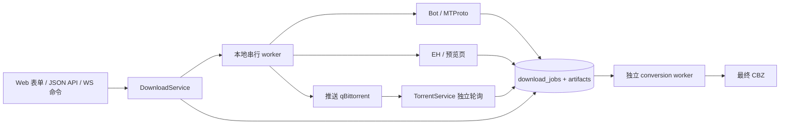
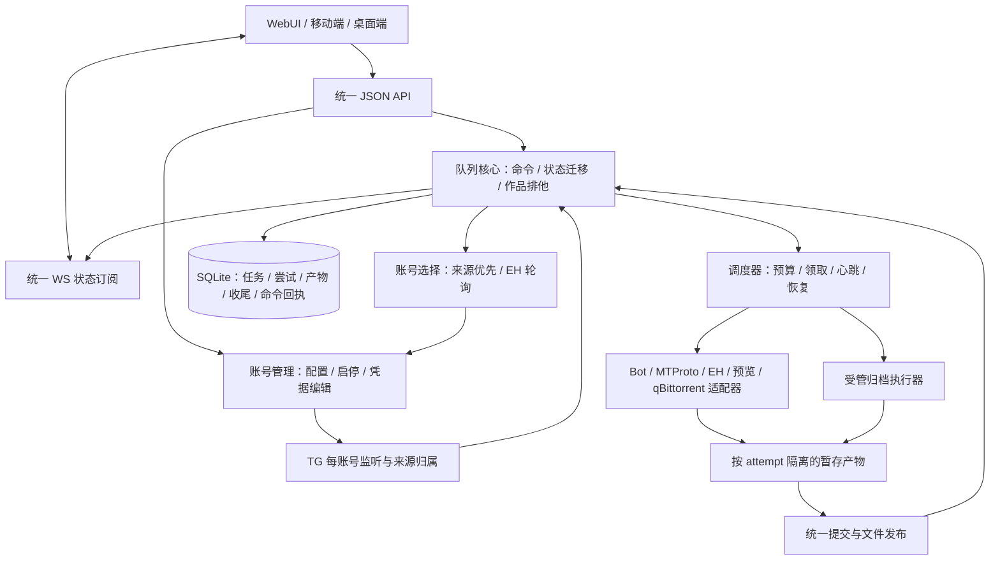

# 下载队列、多账号管理与统一客户端 API 方案

日期：2026-10-13。状态：**方案已批准，按阶段实施中**。实际完成范围见 [处理计划与快速接手入口](DOWNLOAD_QUEUE_AND_SHARED_API_IMPLEMENTATION_PLAN.md)，不能把方案全文视为已上线。方案涵盖多账号、凭据编辑、非破坏性断开、管理员联合登录、统一唯一键与多端并发。

基准：`HEAD=2004b7e`，`0.3.0rc3`，25 个迁移。本方案补充 [全项目审阅记录](PROJECT_REVIEW_2026-10-13.md)，依据当前源码、隔离复现及公开官方文档；没有接入真实 Telegram、EH、qBittorrent 或移动端。

## 1. 结论与明确契约

建议**重建下载/打包队列控制核心，同时建立多账号管理和账号选择模块，逐步把 WebUI 与其他客户端统一到公开 JSON API 和 WS 契约**。已有下载协议、归档安全检查、元数据和认证能力可继续使用，但下载适配器需要去掉自行建任务、更新任务状态和直接发布最终文件的职责。账号管理、来源消息归属和账号轮换是队列模型的一部分，不能等队列完成后再给单账号凭据读取器套一层循环。

这比“只在 cancel 后补一次状态检查”覆盖得更完整；整项目一次性重写则会重新承担已验证的格式、账户、审核和归档业务风险。目前没有证据要求替换 FastAPI、SQLite 或 Jinja2。独立完整后端并不要求微服务或前端框架迁移。

运营者已明确：

1. **允许移除仍在执行的任务记录。** 后端负责停止与收尾，不能要求用户先手动取消。撤回原审阅中“禁止移除运行任务”的建议。
2. **同一作品各下载来源互斥。** A 出问题转 B，必须停止 A 的实际传输；将 A 标为 CANCELLED 不等于停止。
3. WebUI、移动端、桌面端复用同一套后端 API；WS 负责实时通信，客户端不实现下载调度和来源互斥。
4. 可以重建队列。是否重建取决于职责与可靠性问题，而非文件行数或个人框架偏好。
5. **永久单管理员，不考虑多用户。** 多个外部账号是同一管理员配置的连接资源，不是 EhBot 的多个用户；不新增租户、角色、账号所有者或用户配额模型。
6. TG Bot、TG 用户账号、EH 均支持多个账号。TG 各账号独立接收自己的消息；TG 大文件优先由收到入队来源消息的账号下载。
7. EH 操作可轮询账号：A 无法获取元数据或完成归档时换 B，依次尝试，所有可用账号失败后本次操作失败。换账号仍遵守实际执行互斥。
8. 已保存的连接字段默认以 `********` 等掩码显示，可查看、可编辑；不再只显示“已配置”而无法读回。断开/停用保留配置，清除凭据是独立明确动作。
9. **唯一管理员的登录账户名默认 `admin`，可以修改；Web、移动端和桌面端的密码登录均必须提交账户名＋密码。** `admin` 只是首次初始化默认值，不是固定身份、改名后的备用入口或隐藏账号。
10. 同一管理员可同时登录多个客户端；各端操作同一后端状态，多端操作冲突由统一应用命令裁决。版本校验、重复提交和实际执行互斥分别按第 9.7 节处理，不用登录互踢限制并发。

本稿采用的设计假设：

- 多账号摄取以同一套归一化规则生成 **unique_key**，已入库和待入库均通过同一附加信息表匹配；一个键对应一个处理记录及至多一个候选。候选产生后以 `candidate_id` 承接队列身份；不能让未入库阶段各账号先独立处理。相同远端 infohash 另有资源归属约束，不能仅靠 candidate 互斥。
- 移除记录意味着撤销相关在途执行，防止继续产生产物或自动打包；保留文件仍是默认选项，删除文件仍须显式选择。**允许运行时移除已确定；是否允许移除后继续进行一个完全脱管的下载并未确定，本稿不采用该行为。**
- 保留单实例后端和一个调度所有者，先解决正确性，再调整并发；移动/桌面客户端代码不在本仓库本轮改动范围。
- 初版不自动切到收费原档或低画质预览；重试同来源可按错误分类进行，跨来源切换保留用户意图。
- **自动换 EH 账号与自动换下载来源是两件事**：EXHENTAI/A → EXHENTAI/B 在已选择原档操作内执行，EXHENTAI → TELEGRAPH 等跨来源切换仍沿用既定用户意图。

验证目标：切源/换账号无同作品传输重叠；移除不复活；重启不丢意图；账号监听与游标互不干扰；TG 下载归属准确；EH 有界遍历失败；保存字段可显隐编辑、断开后无须重填；管理员改名持久化、所有密码登录必须核验账户名；各客户端产生相同业务结果。

## 2. 当前队列是什么样

现有设计有可保留的部分：任务持久化、优先级/FIFO、来源协议隔离、文件部分原子替换、种子等待不占本地串行 worker、打包错误不谎报下载失败、独立 JSON API、已有认证/CSRF/Origin 检查。

问题是**任务控制权分散**：

- `download_jobs` 同时表达来源任务、重试容器、打包任务与历史；各来源复用固定 idempotency key，重试改旧行，缺少独立尝试身份。
- 下载 worker、EH、预览页、种子 poller、打包 worker、已下载管理各自写状态或产物；没有统一的状态迁移裁决。
- 候选 `status` 又被这些步骤来回改写，审核事实与执行状态混合；有过任务行被当作“曾审批”的凭据。
- 本地 worker 串行不能保证作品互斥：种子已在远端执行，worker 仍会接受同作品其他来源；来源按钮也可直接入队，绕过专门的 `switch_source`。
- Web 与原生端共享了一部分服务，却不是完全同一个公开协议：WS 的 `web.*` 接收表单、返回 HTML，`api.*` 接收 JSON；WS 通过本地 HTTP 桥调用这两组路由。
- 三类连接都是单实例，秘密按固定名字读取；更新账号替换全局连接，无法把一个入队来源绑定到独立账号。数据库虽有 telegram_accounts/account_id 的基础结构，当前运行路径并未实现多账号。

## 3. 专项审阅：证据与优化空间

### 3.1 正确性缺陷，优先级最高

| 问题 | 当前证据位置 | 结果 / 证据边界 |
|---|---|---|
| 来源互斥不存在 | `app/downloads/service.py:238`；`app/api/actions.py:820` | 实际 enqueue 允许一个候选的种子 WAITING_TORRENT 与 EH DOWNLOADING 并存；远端运行由受控适配器代表 |
| 本地取消未终止传输 | `app/downloads/service.py:637`、`:807`、`:1368` | 初轮屏障复现 CANCELLED 最后变 COMPLETED；实际 provider 等待没有单任务取消协调 |
| 移除后任务可复活 | `app/downloads/archived.py:517`；`app/exhentai/service.py:425`；`app/telegraph/service.py:240` | 新复现移除 2 条记录后，实际 EH 持久化逻辑再次创建 EXHENTAI / COMPLETED 行 |
| 推送种子期间取消，撤销遗漏 | `app/downloads/service.py:741`、`:1296`、`:1309` | 取消只 abandon WAITING_TORRENT；DOWNLOADING 推送尚未记录 handle，随后 park 无条件写回 WAITING_TORRENT；新复现 abandon 调用 0 次 |
| 远端停止失败却继续切源 | `app/torrent/service.py:240`；`app/downloads/service.py:771` | 实际 abandon 吞掉配置/连接异常，switch 仍入队 B；新复现 A=CANCELLED、B=PENDING、无停止确认；未声称真实远端已测量发生重叠 |
| poller 旧快照可覆盖取消 | `app/torrent/service.py:287`、`:348`、`:608` | 读取等待任务后可与取消交错；完成提交无状态/尝试条件；实际完成方法把已 CANCELLED 的行写成 COMPLETED |
| 源下载完成与自动打包之间不可靠 | `app/downloads/service.py:1383`；`app/torrent/service.py:425` | 完成和调用 enqueue 是两步；中断可留下“下载完成、打包意图未兑现”，异常只记录日志，没有持久化补偿；这是源码路径分析，未做杀进程复现 |
| 重下并打包没有依赖模型 | `app/downloads/archived.py:712`；`app/conversion/service.py:822`、`:1110` | 初轮复现下载已 PENDING，打包却报 ARCHIVE_NOT_READY；另一个来源存在时还可能选旧产物 |
| 租约不能可靠代表执行所有权 | `app/downloads/service.py:891`、`:938`、`:1089` | 启动只回收一次；固定 worker 名、5 分钟不续租；初轮复现快速重启遗留任务在到期后仍无人执行 |
| 预览页失败不收束全部子下载 | `app/telegraph/fetcher.py:108` | gather 首个异常返回时其他子协程继续运行；真实 fetch_all + 受控子下载复现兄弟请求在返回后继续；必须先取消并等待全部子请求结束再释放尝试 |

第 1、2 项“允许删除”和“取消切源”不能分开修：删除记录会丢掉取消句柄，适配器又可能建回任务行，旧完成还可能自动打包。需要一次执行从领取到文件发布的完整约束。

### 3.2 调度、资源和打包的设计缺口

1. **一个大本地下载会挡住其他本地任务。** `_process_one` 直接 await 传输，不是短调度回合。优先级对已运行任务不抢占，这是合理语义；如需提高吞吐，应由调度器发起受控任务，而非增加多个无协调 worker。
2. **停车不等于不占资源。** 种子 WAITING_TORRENT 释放本地槽是合理的，但真实传输仍在 qBittorrent；当前服务逐个推送，没有 EhBot 层面的远端在途预算。qBittorrent 自己的队列设置可能限制活跃数，不能据此认为 EhBot 已保证预算或作品互斥。
3. **取消协程不等于终止线程。** 打包在 `asyncio.to_thread(processor.process)` 中运行，`stop()` 只取消 await；processor 又自己 `.replace(destination)`。尚未做真实 7-Zip/线程取消联调，但源码已足够说明只补 `task.cancel()` 不完整。发布权应移回协调器；需硬终止的打包用受管子进程，否则必须协作停止并等待线程退出。
4. **资源与临时路径缺少尝试隔离。** 现有文件名按 job/candidate/gallery 或目标名固定；重试复用这些名字。取消未收束时，后续尝试可能碰到同一 `.part` 或最终路径。应按 attempt 隔离工作目录。
5. **预览图累计大小检查偏晚。** fetch_all 收齐图片后才检查 max_total_bytes，且 gather 为所有图片创建任务。并发信号量只限制同时请求，不代表总内存已受约束。建议边接收边计数并中止超限，减少同时驻留字节；未做内存压测，不给虚构峰值。
6. **审批与执行应解耦。** `service.py:269` 以“存在旧任务”放宽入队。删除记录后该事实丢失，迁移应保留明确审核事实；不能让下载历史是否存在决定审核资格。
7. **状态投影不能兼任控制查询。** downloaded_work 选择一个带 ARCHIVE 的任务用于展示可以，但取消、切源、清理须枚举当前执行及其资源，不应根据这一展示对象裁决。
8. **文件事务与 DB 事务不等价。** ComicInfo 长写锁问题见原报告。下载发布、打包、重命名、移除也应采用作品级排他协调、短 DB 事务及可恢复文件提交，不把整段 I/O 塞进 SQLite 写事务。

### 3.3 本轮额外验证

`.scratch/download_queue_review_repro.py` 执行返回 0，输出：

| 隔离场景 | 实际结果 |
|---|---|
| 同作品两个来源 | remote=WAITING_TORRENT，local=DOWNLOADING |
| 推送期间取消 | response=CANCELLED，final=WAITING_TORRENT，abandon_calls=0 |
| 离线远端切源 | old=CANCELLED，new=PENDING，remote_stop_confirmed=false |
| 移除后适配器收尾 | 移除 2 条 → 剩余 0 条 → 出现 EXHENTAI / COMPLETED |
| 旧种子完成 | response=CANCELLED，final=COMPLETED |
| 一个预览子请求失败 | fetch_all 返回后另一个子请求仍继续 |

复现使用临时数据库、文件与可控适配器/屏障，实际服务与持久化方法参与执行；不连接真实供应商。旧脚本和初轮 1778 个不同测试的结果仍保留在原报告，不把新增场景当作整库回归已通过。

### 3.4 多账号与凭据管理补充审阅（静态确认）

| 当前设计 | 源码证据 | 新要求下需要调整的地方 |
|---|---|---|
| 全局一份 Bot/EH/用户状态、worker、登录挑战与实体缓存 | `app/connections/manager.py:91`、`:106`、`:113`、`:119`；`app/wiring.py:113`、`:124` | 账号注册表与每账号运行上下文；不能只把页面改成账号列表 |
| 断开会删凭据 | `app/connections/manager.py:659`、`:830`、`:840` | Bot 删 Token、EH 删 Cookie、TG 用户删 API 对和 session；与新要求冲突，改为断开保留，删除独立 |
| 保存字段不回显 | `app/web/templates/settings/_connections.html:1`、`:34`、`:117`、`:163`；`app/api/settings.py:192`、`:836` | 表单可重新输入，但无法读回原值或显示后编辑；改成真实已保存字段的掩码、显隐与部分更新 |
| Bot 更新身份及游标全局 | `app/db/database.py:1465`、`:1484`；`app/db/migrations/003_telegram_bot_updates.sql:1` | update_id 要按 Bot 账号分区，offset 每账号独立；不能拿 A 的最大 ID 作为 B 的 offset |
| Bot/MTProto 摄取都落入固定 Bot 身份 | `app/db/database.py:740`、`:1667`；`app/connections/manager.py:536` | save_candidate_message 必须传入真实 ingest_account_id / transport；保留各账号观察到的消息及附件 |
| 用户账号读取固定来源集合，游标按 chat_id 写入 | `app/db/database.py:1129`、`:1153` | 来源订阅与游标按 account_id + chat/peer 分区；当前游标写入不能复用到多账号 |
| 来源决策与下载只看全局“用户账号可用” | `app/review/orchestration.py:113`；`app/downloads/service.py:1216` | 选择来源时保留具体消息和账号；执行不能读取“当前默认账号”替代入队来源账号 |
| EH 单个凭据供应器 | `app/exhentai/service.py:218`、`:254` | 元数据与原档均经过统一账号选择；gdata 无 Cookie 的现有路径单独处理，不给匿名请求伪造账号 |

这些是对当前实现的静态核对及新增需求带来的设计差距，不计入初轮 8 个缺陷，也没有读出真实 Token/Cookie/session。当前 `source_messages` 的账号复合键可复用，但要先修正实际身份写入与上层投影。

### 3.5 管理员账户名与登录补充审阅（静态确认）

| 当前设计 | 源码证据 | 新要求下需要调整的地方 |
|---|---|---|
| 登录页面及 Web 处理器只接收密码 | `app/web/templates/login.html:58`；`app/web/routes/auth.py:50`、`:62`、`:95` | 增加账户名输入；联合校验账户名与密码，不再查询/写入固定 `admin` |
| 原生 JSON 登录同样只核验密码 | `app/api/auth.py:115`、`:122`、`:138` | 共享登录校验，JSON 必须包含 username；不能留一个只凭密码可进入的旧入口 |
| whoami 的 Bearer 身份写死 admin，Cookie 从登录时的 session 取名字 | `app/api/auth.py:219`、`:225`、`:234` | 各种认证方式均返回数据库中当前登录名；改名后旧会话不展示旧名字 |
| 改密码仍按固定 admin 读写 | `app/web/routes/auth.py:145`、`:168` | 按唯一管理员的稳定内部 ID 操作，改名后改密码仍可用 |
| 启动按 admin 查找并初始化 | `app/wiring.py:363`、`:369`；`app/db/database.py:1251` | 只在不存在唯一管理员时初始化；不能因名字变更再次创建 admin |
| 管理员表已有独立 id 与 username | `app/db/migrations/002_admin_auth.sql:1` | 复用 id 作为固定主体，只更新 username；表名复数不代表应增加用户管理 |

这里是新增产品契约的差距，不另增初轮缺陷计数。启动重建默认账号是沿用旧查找逻辑实施改名后会引入的风险，未声称当前产品已支持改名或已复现该问题。详细契约见第 9.6 节。

### 3.6 多账号并发匹配补充审阅（静态确认）

- `app/candidates/ingestor.py:103` 命中已有画廊即 IGNORE，`:160` 随后跳过消息入库；这会丢掉另一账号的来源路径。直接进入保存函数时，`app/db/database.py:1835` 也会忽略重复画廊而不关联新来源。本方案改为“不新建候选，但保留合格账号观察”，不沿用 R59 的整条丢弃机制。
- 前置闸门按 ex_gid，入库查重却按 ex_gid + token（`app/db/database.py:1828`），表唯一约束也是这两列（`app/db/migrations/001_initial.sql:48`）。它们不是同一匹配规则；并发通道同时通过前查、Token 不同或来自其他入口时，不能由该约束保证一个画廊一个候选。这里为静态缺口，未运行新的并发复现。
- `app/candidates/models.py:28` 的解析结果未保存转发原消息坐标；Bot/MTProto 翻译也未提取 forward_origin / fwd_from。仅有接收群和 message_id 不能匹配不同群里的同一来源转发。

修订方向不是为每种来源各造一套去重服务，而是统一生成键、统一登记附加信息、统一领取处理权。Telegram 标识范围及转发信息不完整的边界见第 8.3.G 节。本轮没有修改摄取代码或新增产品测试，不改变初轮缺陷/测试统计。

### 3.7 多端操作补充审阅（静态确认）

现有 `app/db/database.py:4318` 的系统设置保存是逐键 upsert，没有客户端读取版本的条件裁决；数据库事务可以串行提交，但不能据此保证旧页面不会覆盖其他端已保存的值。`app/web/routes/auth.py:168` 修改密码后另行撤销密码派生 Token，`app/api/auth.py:194` 刷新也先撤销再另行签发，认证相关并发需统一处理。这里为源码路径核对，未新增多端并发复现，也不计入初轮缺陷统计。

本稿原有 task revision、generation、command receipt 与 WS resync 仍保留；第 9.7 节把这些规则扩展到设置、元数据、审核、账号及认证，并定义冲突时客户端如何保留输入、刷新和重新确认。

## 4. 同类案例：哪些经验可以直接用

以下页面于本轮实际读取；只借鉴官方描述的契约，未声称审阅了这些项目的全部实现。

| 项目 / 官方资料 | 官方明确设计 | 对 EhBot 的具体借鉴 |
|---|---|---|
| [aria2 RPC](https://aria2.github.io/manual/en/html/aria2c.html#rpc-interface) | `remove` 对运行中的下载先停止，状态成为 removed；`removeDownloadResult` 另行移除已完成/出错/移除的历史结果；`tellStatus` / `tellActive` / `tellWaiting` / `tellStopped` 与调序分开 | 稳定任务句柄、查询与控制分离；记录移除不能代替执行停止；暂停/取消/历史清理有明确语义 |
| [SABnzbd 4.5 API](https://sabnzbd.org/wiki/configuration/4.5/api) | Queue / History / Status 接口分组；按 nzo_id 操作；任务可携带 pp 后处理选项；queue delete 的 del_files 显式控制文件，默认不删已下载文件 | 下载与后处理分阶段，打包意图随任务持久化；队列/历史分开投影；记录与文件选项独立。无需照搬其 NZB 专用模型或 API Key URL 写法 |
| [qBittorrent 5.0 WebUI API](https://github.com/qbittorrent/qBittorrent/wiki/WebUI-API-%28qBittorrent-5.0%29) | 按 hash 查询 torrent；stop / start / delete 分开；deleteFiles 显式；sync/maindata 提供 rid、full_update 与删除集合；stop/delete 文档中 200 为 All scenarios | 保存远端资源身份，远端操作后查验目标状态；不能只以 HTTP 200 为“确实停止”证明；借鉴快照/增量重置契约。5.x 与 4.x 动作名不同，接入时探测版本，不能机械替换现有 client |
| [BullMQ stalled jobs](https://docs.bullmq.io/guide/jobs/stalled) | 活动 worker 需持续报告仍在工作；失联任务回 waiting 或 failed；限制反复 stalled 次数；CPU 阻塞会妨碍心跳 | 执行所有权、心跳、回收与有界重试一起设计，不能只加定时扫描。借机制，不引入其 Node/Redis 部署 |
| [JDownloader 账号管理](https://support.jdownloader.org/en/knowledgebase/article/where-should-i-buy-and-enter-my-premium-account) / [Cookie 登录与同站点多账号](https://support.jdownloader.org/en/knowledgebase/article/account-cookie-login-instructions) | 独立 Account Manager 保存账号并展示状态；官方明确支持同站点多个 Cookie 账号，分别保持登录会话 | 用账号列表代替一次性连接表单，配置与运行状态分开；Cookie 按账号隔离；在浏览器退出可能使导入会话失效，不能把网络登录失效与删除本地配置混为一谈 |
| [pyLoad AccountManager](https://github.com/pyload/pyload/blob/a94af3038786a0ed7d4bccafbd563828de2fc1bc/src/pyload/core/managers/account_manager.py) / [BaseAccount](https://github.com/pyload/pyload/blob/a94af3038786a0ed7d4bccafbd563828de2fc1bc/src/pyload/plugins/base/account.py) | 按插件/账号保存、更新、删除；select 过滤无效、到期、无流量账号，并使用最久未使用的合格账号；切换账号重新绑定请求上下文，密码更改清理旧 Cookie jar | 建立账号资格、使用顺序、每账号请求/session 隔离和编辑后的版本更新。借账号模型，不照搬其 premium/free 优先级或依赖明文 cfg 的存储实现 |
| [Telegram Bot API](https://core.telegram.org/bots/api#getfile) / [文件身份约束](https://core.telegram.org/bots/api#sending-files) | file_id 属于具体 Bot，不可移到其他 Bot；file_unique_id 可跨 Bot 一致但不能下载；getUpdates offset 决定确认哪些更新 | Bot file_id 必须和原 Bot 绑定；多 Bot 游标独立；不能以“同一文件”为由换 Token 继续 getFile |
| [Telethon Sessions](https://docs.telethon.dev/en/stable/concepts/sessions.html) | session 保存授权状态与账号所见实体；StringSession 可持久保存 | 断开保留有效 session；session、实体缓存和登录流程按账号隔离。官方文档未承诺跨账号复用 access_hash；本项目现有逻辑也明确禁止该复用 |

aria2 可作为未来新增下载适配器，但不能直接接管 EH 取链接/GP、MTProto、预览页整合与 CBZ 业务。换成 Celery/BullMQ/aria2 都不会自动解决作品级互斥、产物版本、删除墓碑和统一客户端契约。

多账号资料为本次实际读取；pyLoad 对照核对时 develop HEAD 为 `a94af3038786a0ed7d4bccafbd563828de2fc1bc`。上述官方资料未证明其界面均符合本项目“默认掩码、允许显示和编辑”的要求；显隐交互是运营者已明确的本项目契约。

## 5. 方案比较

| 方案 | 能解决的范围 | 成本 / 风险 | 判断 |
|---|---|---|---|
| A：逐个服务补取消、互斥与状态条件 | 可先压住部分竞态 | 每个 provider、poller、转换和移除路径都需重复裁决；任务身份仍混合 | 可作为短期止损，但不能当作目标架构 |
| B：重建队列控制核心，复用协议与归档算法 | 统一取消/切源/删除/恢复、持久化依赖、共享 API | 需要数据迁移和适配器职责调整；可以按业务切片替换 | **推荐** |
| C：直接换外部通用任务平台 | 提供通用领取/重试/心跳等机制 | 新基础设施；业务状态仍需自己建，传输取消仍需自己实现 | 暂无部署规模证据支持 |
| D：后端、数据库与所有客户端一次性重写 | 可以重新定义所有层 | 回归面最大；丢失现有协议/格式经验，交付很难逐步验收 | 不推荐 |

推荐 B 的重建范围是**控制模型与提交权**，不是删除整个 downloads 包后再把旧逻辑换名字搬回来。

## 6. 目标模型与模块职责

队列核心是一个行为集中、对外接口较小的模块：调用方只需提交开始、取消、切源、移除、重试、打包、优先级命令和查询状态，不需要先查 N 个服务再按顺序调用。事务、实际取消、失联处理和旧尝试拒绝在模块内部解决。

### 6.1 任务与尝试分开

| 对象 | 身份与职责 | 必要字段 / 约束草案 |
|---|---|---|
| task | 用户管理的一项作品流水线 | UUID task_id、candidate_id、selected_provider、status、stage、generation、revision、priority、pack_requested、current_attempt_id；同作品最多一项未结束下载流水线 |
| attempt | 一次真实执行，重试必须新建 | UUID attempt_id、task_id、generation、kind=DOWNLOAD/PACK、provider、状态、lease_owner/session、heartbeat/expiry、attempt_no、错误、远端 handle、input_artifact_id、暂存/发布信息 |
| artifact | 成功提交的一版原档或 CBZ | 唯一 artifact_id、生产 attempt_id、类型、校验/大小、路径/状态；打包精确绑定一个 input_artifact_id，不能临执行时按候选找“最新来源” |
| cleanup operation | 用户记录已移除后的必要收尾 | 独立 operation_id、旧尝试身份、资源归属、停止/删文件意图、待清理路径、状态/错误/重试时间；不随 candidate/task 级联删除 |
| command receipt | 跨 HTTP/WS/重连的命令幂等记录 | 主体身份 + idempotency key、规范化命令/参数摘要、操作/任务身份与结果；同 key 不同内容返回冲突；记录有界保留 |
| external account | 单管理员管理的外部连接资源 | account_id、kind=TG_BOT/TG_USER/EH、别名、远端稳定身份、enabled、运行状态、credential_revision、私有凭据引用、按操作的健康/冷却与使用顺序；不是用户表 |
| source subscription / observation | 某账号订阅和实际观察到的一条消息 | account_id + 规范 chat/peer + message_id / update_id；来源规则、游标、附件/媒体组/回复归属；候选可保留多个 observation |
| ingest entry | 同一 unique_key 的摄取处理记录与附加信息 | 一张新增表统一匹配已入库/待入库；unique_key 唯一、candidate_id 可空、处理状态/修订号、处理所有权/租约、extra_json；已有 source_messages 保存各账号附件 |

task 增加选中的 source_observation_id / origin_account_id 与账号选择策略；attempt 必须保存实际 account_id 和 credential_revision；产物保留非敏感的账号/来源溯源。凭据值不进入任务、产物或日志 JSON。command receipt 的认证主体为唯一固定管理员，不能按每个 access token 分割同一管理员的跨端幂等，也不引入用户所有者字段。

这是模型草案，不是已实施的 DDL。实施时可沿用/扩展现有 artifacts 和审计表，不要求为每个概念另造一套公共抽象。文件发布恢复信息可存在 attempt 的明确字段中；不做通用 DAG、事件溯源或工作流平台。

本稿在方案内统一术语，不另建一套领域文档：**唯一键 unique_key** 指等价数据经过统一归一化得到的匹配值；**处理记录 ingest entry** 指这个键在待处理至已入库期间的同一条记录；**账号观察 observation** 指某账号实际收到的消息及其可访问附件。不要把附加表的自增 ID、Bot update_id、账号 ID 或具体下载用 file_id 称为这里的唯一键。

具体约束：

- task revision 用于并发修改裁决；generation 用于撤销旧执行资格。优先级/进度等常规变化不必撤销当前 attempt。
- 取消、切源、移除、重新开始须明确使旧 generation 失效。完成、失败、进度、元数据来源补写、登记产物、启动下游，都必须验证 attempt + generation + 允许状态。
- 数据库有唯一约束保证同作品逻辑槽；同一短事务裁决领取/切源，检查和状态条件写入不可拆开。唯一约束只能阻止合法新领取，不能停止物理旧执行，必须配合停止确认。
- 审核通过是独立事实，保存/迁移既有有效审批记录，不能从“存在任意下载任务”推断。
- 历史来源/产物可保留；历史任务不再作为未来领取容器。做种是独立资源状态，下载完成后不占活动下载阶段，但移除/停止做种仍要管理它。
- 账号 A → B 必须产生新的 attempt；同来源内换账号也核实 A 结束并拒绝 A 的陈旧提交。增加账号数量不会增加同作品允许的活动下载数。

### 6.2 状态必须说明实际含义

| 状态 | 含义与后端行为 |
|---|---|
| QUEUED | 持久化意图已接受，尚未执行 |
| PAUSED | 暂停领取；第一阶段只保证队列暂停，活动暂停由 provider 能力决定 |
| RUNNING | 本地或远端下载/打包实际执行中；stage 和 provider_state 表达具体阶段 |
| RETRY_WAIT | 有界同来源重试等待 next_run_at；不是已失败或人工暂停 |
| WAITING_INPUT | 密码/分卷/路径等人工输入；附 reason，下载并未因此重新执行 |
| STOPPING | 停止意图已提交，可能仍在传输；占用实际资源槽 |
| BLOCKED_STOP | 远端或执行器停止无法确认；继续管理收尾，B 不得开始 |
| CANCELLED | 确认实际停止，且没有有效完成提交 |
| SUCCEEDED / FAILED | 本次尝试有确定结果；流水线结果另看下载/打包产物 |

task 的展示状态从 stage 和 attempt 结果投影，不能用候选审核状态代替。`pack_requested=false` 时原档提交即可完成该任务；为 true 则原档成功、打包失败分别展示，保留可用原档。

## 7. 三个关键操作的精确定义

### 7.1 切源 A→B

1. **先检查 B 可用与参数有效，再撤销 A。** 不要先取消，才发现 B 没有账户/附件/链接。
2. 同一短事务验证 expected_revision，持久化目标来源 B 与切源意图；旧 attempt 失去提交资格、状态 STOPPING。新 B 暂不领取。
3. 取消本地受管任务并 await 实际退出；预览页取消所有子请求并等待收束；线程/子进程按其停止协议确认。
4. 远端种子按归属执行 stop/delete 并查询确认停止/消失；推送中取消必须等推送结果可核实后补做撤销，不能因为暂时没 hash 就结束收尾。查询及清理有退避，不能永久占着请求连接。
5. **停止确认后才释放 A 槽，创建/激活 B 的新 attempt。** 若 A 结果回来，旧 generation 只能交还隔离暂存物供清理，禁止发布、改作品状态或自动打包。
6. 停止未确认则 BLOCKED_STOP，API 返回接受的操作身份，状态说明“切换等待旧来源停止”；不谎报切源完成，不启动 B。

如果 qBittorrent 无法连接，无法同时保证“马上启动 B”和“A 必定已停止”。本稿选择满足已明确的互斥要求：B 等待。用户可在远端修复后重试停止确认；不能用“忽略错误”兑现物理互斥。

所有入口遵循此流程：来源按钮、API pull source、专门 switch source、重下、自动路由与去重删除不能绕过队列核心。已结束 A 切 B 不需停止不存在的传输，但仍需核实遗留远端执行。

### 7.2 移除运行记录

1. 短事务先阻止新认领并撤销所有相关 attempt 的提交资格；把停止所需远端身份、执行身份和路径转交给独立 cleanup operation。
2. 用户可见任务记录移除，发布删除事件；无需用户提前取消。物理删除任务行可随事务完成，内部收尾凭据不依赖该行继续存在。
3. 请求并确认下载/打包/相关远端资源停止；活动文件不能先 unlink 再让旧线程继续写。保留文件选项只保留已经存在的文件，不授权继续生成新文件。
4. 显式删文件时，在执行停止及文件归属确认后清理；失败报告 failed_files 或收尾状态，不能宣称全部完成。已发布文件与仅属于旧 attempt 的残片分别处理。
5. 普通移除保留候选、元数据、审核与现有记录审计；彻底删除保留当前摄取墓碑语义。cleanup 不通过已删除候选外键生存，也不得重新创建 candidate/job。
6. 相同作品立即重新入队时，如果旧执行还未停止，仍等待其收尾；新 task/attempt 使用新 UUID，防止 SQLite 数字 ID 复用造成旧提交误认。

这是“允许删除记录 + 后端继续完成必要清理”。内部残留的收尾信息应可通过操作状态查询，并在成功后按审计保留策略压缩；不是永久隐藏一个仍正常运行的下载。

### 7.3 下载后打包、重下与发布

- 入队时持久化 `pack_requested`；自动打包默认设置只决定新任务的默认值，显式 repack 意图不能因开关变化或重启丢失。
- 原档成功提交时，在同一 DB 事务记录 artifact、完成下载 attempt，并建立绑定该 artifact 的打包意图/attempt。仅唤醒 worker 的通知可以丢失，数据库意图不能丢失。
- 打包读取指定 artifact 版本；B 尚未完成时不能悄悄读取 A 的旧产物。旧 CBZ 在新版本成功发布之前保持可用。
- provider/processor 输出 attempt 独享的 staging 文件和结果，不自行创建任务或更新全局候选状态，不直接覆盖最终 CBZ。
- 协调器在作品发布排他区中核实当前资格并提交最终文件；昂贵下载/哈希/压缩在 DB 写事务外做。取消/移除与发布采用同一串行裁决：已经提交成功再收到取消应报告已完成，已接受取消后禁止发布。
- 原子 rename 只保证单个文件替换，不能保证 DB/文件一起提交。发布采用可恢复的“准备记录 → 文件替换 → DB 结果确认”：保存旧/新版本和路径信息，启动时检查校验值确定完成、恢复或清理；取消/删除遇到准备中的发布先完成裁决。跨卷先复制到目标卷暂存后替换，沿用现有文件验证能力。
- 原档删除必须在打包成功提交、输入使用结束后，根据 keep_original 策略执行；下载/打包失败或取消不能删掉最后一版有效产物。

## 8. 执行器、资源归属与恢复

### 8.1 适配器接口

各真实来源在同一 seam 上交付能力：开始执行、停止并确认、查询/重新附着、报告进度、返回暂存结果。根据实际差异允许本地协程适配器与远端 handle 适配器，不能强迫 qBittorrent 模拟一个阻塞的文件下载函数。

执行上下文至少含 attempt 身份、generation、隔离目录、取消信号与进度回调。适配器能力描述是否可活动暂停、可续传、属本地或远端、是否有质量/费用提示。只声明实际验证过的能力；不强行实现所有来源的断点续传。

- Bot：关闭请求/流，取消后收束文件句柄与 partial；当前异常清理只覆盖 HTTP/OSError，需补真实取消路径验证。
- MTProto：取消该尝试并断开它的下载客户端，等待关闭；保留现有独立长传输连接策略。
- EH：取链接/费用阶段也在受管尝试内；取消能阻止后续传输，不承诺已发生的 GP 消耗可撤销。
- 预览页：子任务成组管理，任一失败或取消都先终止并等待其余任务；图片与 ZIP 输出进入 attempt 目录。
- qBittorrent：资源登记保存远端实例/连接身份、hash 与归属；推送前有意图，响应丢失后能按 hash 查回，不能无脑重推。
- 打包：优先受管子进程提供硬停止和子进程树收束；若某路径保留线程，必须支持协作取消并等待线程退出，且线程仅输出 staging。不把取消 await 当作线程已退出。

共享 infohash 不能随便 delete：若外部已经有该种子，或多个记录引用它，归属/独占控制权未确定时拒绝附着为受管活动下载并给出清楚错误。需要严格停止能力的来源应使用 EhBot 可控制的实例或独占资源；category/tag 只是标识，不证明所有权，也不隔离同一个实例上的相同 hash。

移除/切源默认不调用远端 deleteFiles=true；远端目录与本地 library 路径不总相同。删文件只在归属和路径映射验证后执行。停止旧远端仍可能保留已有字节，符合默认保留文件语义。

### 8.2 调度与恢复

- 一个调度模块持有认领权；每次领取是短事务，完成条件/预算满足后才发起独立受管 attempt。支持多个客户端不等于需要多个后端调度进程。
- 保留优先级 + FIFO 基线；失败重试按 next_run_at 与最大次数执行，新任务与重试任务均受预算。先补事实指标再决定是否增加优先级老化等策略。
- **本地下载预算、远端在途预算、打包预算分开核算**；外部等待和 STOPPING 不能假装释放远端占用。种子等待不阻塞其他来源的可用本地槽，但也不能无限推送。
- 第一阶段保持当前本地下载 1、打包 1 的并行度；远端在途上限需实施前核对当前连接和 qBittorrent 队列设置后定值。本稿不凭审阅给出“最佳并发数”。只有正确性通过后才做可配置扩容。
- 每个活跃本地 attempt 记录唯一 worker_session 与周期心跳；lease 表示执行所有者仍存活，不由文件字节增长决定。周期恢复需验证所有者失联，并撤销旧 generation 后重新执行。
- 强制单实例调度的前提下，确认前实例已退出后可立即恢复本地残留；不必机械等满旧 5 分钟。若未来多实例，必须先设计实例锁/租约，不沿用所有者恒为 worker 的逻辑。
- qBittorrent 资源不会因 EhBot 重启消失：启动先重新附着/确认/停止，再决定是否重试。STOPPING、切源目标、删除 cleanup 都需恢复；不能统一改为 QUEUED。
- 重试分类：网络瞬时故障有界退避；凭据失效/缺密码/缺卷等等待人工；确定的格式拒绝终止；错误文案与内部 cause 保留现有脱敏约束。
- 停机先停止新领取，收束本地任务/子进程，持久化未完成停止意图；远端继续还是停止遵循已确定意图与恢复策略。必须覆盖“应用进程已结束但子进程仍活着”的场景。

衡量优化的指标：入队等待时间、活跃槽与远端等待数、取消确认耗时、重试/回收次数、下载吞吐、打包耗时、内存/磁盘压力、DB 锁等待；日志统一关联 task_id / attempt_id / operation_id。吞吐提高必须以不增加来源重叠和陈旧发布为前提。

### 8.3 多账号管理、监听与账号选择

#### A. 一个管理员，多项独立连接

TG Bot、TG 用户账号、EH 各自允许新增多条账号记录，有稳定 account_id、别名、平台身份与可编辑配置。无账号总数的任意产品限制；运行资源仍受总预算和每账号预算约束。qBittorrent 仍按第 8.1 节管理远端资源，本次不顺带扩成多个种子实例。

采用一个 AccountRegistry/AccountSelector 模块，封装配置、上下文与资格选择；TG Bot、TG 用户、EH 使用各自真正不同的 adapter。当前 ConnectionManager 的全局锁、状态、实体缓存、登录挑战和任务引用拆为每账号上下文，不保留一个巨型“当前账号”变量供所有操作覆盖。

| 动作 | 凭据与运行行为 | 在途任务处理 |
|---|---|---|
| 保存 | 原子保存配置/凭据版本，可显示未验证或待登录状态；不因外部网络暂时不可用而丢掉填写内容 | 不覆盖正在使用的旧上下文；成功启用新版本前检查平台身份 |
| 测试连接 | 验证本账号，更新状态/原因，不把测试失败变成清空字段 | 不改变其他账号，不取消无关任务 |
| 停用 / 断开 | enabled=false；停监听及新操作选择；保留 Token/Cookie/API 配置、手机号与有效 session；重启后仍停用 | 通过核心请求停止该账号活动尝试并收束；可按已有策略换其他合格账号，停止未确认时不并行接替 |
| 启用 / 重新连接 | 使用已保存值恢复；session 在平台端确实已失效时才进入重新登录 | 不重新发起已完成任务；未完成意图重新核对资格 |
| 编辑 | 部分字段更新、credential_revision 增加；当前输入未变就不重复写掩码；别名变更不重登 | 凭据变更先停止本账号旧尝试/监听，按版本重启；不让运行中请求中途改用另一套 Cookie |
| 取消登录 | 仅取消指定 account/login_flow 的挑战，保留配置与已有可用会话 | 不调用“删除整个账号”，不影响另一个正在登录的账号 |
| 清除登录会话 | TG 用户本地 session 清除，保留 API ID/Hash/手机号；远端注销若需要作为明确单独动作 | 先收束使用该 session 的尝试，转 NEEDS_LOGIN；不是普通断开 |
| 删除账号 / 清除凭据 | 明确删除配置/凭据；普通停用不走此路径 | 先停止并处理引用；历史仅保留非敏感 account_id/别名/身份摘要，不级联删除任务、消息与归档 |

保存与连接分开，验证码/两步验证流程不再强迫用户重复填写已保存 API 信息。验证码、一次性登录挑战不长期保存；两步验证密码沿用现有仅供本次验证的行为，不为了“可编辑”额外保存原本未存的密码。TG 的手机号配置要持久化，不能仅停留在内存 challenge 中。

同一个 Bot/Telegram 用户/EH 平台身份不能作为两个启用账号重复注册以假装独立资源：检测重复并定位已有记录。换 Token 但仍同一 Bot 可更新凭据；若变成另一个 Bot，应新建账号，不能让旧 Bot 的来源和 file_id 绑定到新身份。TG 用户手机号改变并验证为新平台用户同理。API ID/Hash 是应用配置，不是 Telegram 用户身份，同一 API 配置可用于不同合法用户会话，仍须分别存储/隔离。

#### B. 保存字段的掩码、显示与编辑

账号列表展示别名、类型、平台名称、启停、连接状态与错误；敏感输入已保存时展示固定掩码 `********` 和“已保存”，提供“显示/隐藏”及“修改”。手机号、API ID 等登录配置同样可在编辑面板读回，默认按该面板掩码显示；别名、公开用户名与状态直接显示以便区分账号。

具体行为：

1. **掩码只是显示状态，不是字段值。** 未触碰字段保存保持原值；只修改一个 Cookie 字段不要求重填其他两项。修改模式可直接覆盖，也可先显示现值再编辑。空值、清除、字段不存在必须分别定义，不能以空字符串统一擦除全部凭据。
2. 点击“显示”由已认证客户端显式读取指定账号的可查看配置，临时显示真实已保存值；再次隐藏、离开面板或退出登录后回到掩码。无须重新输入管理员密码或增加第二个用户权限流程。
3. 允许查看/编辑 Bot Token、EH Cookie 三字段、TG 已保存的 API ID/Hash/手机号等配置。原生端复用同一读取与更新 API，不能只有 Web 才能查看。运行时自动生成的 Telethon session 由会话模块持久化，本稿不新增 session 导入/导出界面；它不是当前需重填的表单字段。
4. 列表/通用设置快照/WS 广播不携带明文秘密；显式查看响应不缓存、不写日志，编辑请求也不回显到错误、审计或通用状态事件。浏览器仅在这次编辑面板持有必要明文，不把它持久化到 localStorage。
5. 数据继续使用现有私有凭据文件/存储能力，按 account_id + credential_revision 命名且原子写入；普通数据库行仅存引用。项目当前 SecretStore 只接受小写字母、数字和下划线，命名需遵循这一实际限制。文件创建成功但 DB 绑定失败时可清理未引用版本，DB 先绑不存在凭据文件则不可接受。

项目旧规则 `AgentHelp/AGENTS.md:773` 为“Credentials: never plaintext, never echoed to a page, never logged”，模板也据此只展示空输入。本次明确需求替代其中“管理员不能查看已保存配置”的产品限制；实施时应同步改成“默认掩码，认证管理员显式查看/编辑，日志和广播继续脱敏”。`AGENTS.md:787` 的日志脱敏仍保留。本稿先记录这个规则变更范围，不在未实施时修改主规则。不会读取或在审阅报告中展示真实凭据。

#### C. TG 多账号监听与消息归属

- 每个启用 Bot 有独立长轮询任务与 offset，`telegram_bot_updates` 唯一键为 `(account_id, update_id)`；对同一 Token/平台 Bot 只运行一个 poller，避免 getUpdates 冲突。
- 每个启用 TG 用户账号有独立 session、EntityIndex、已检查来源集合、不可读来源缓存、登录锁与 ingest loop。保持现有“按来源增量拉消息”的协议，先做多账号隔离，不顺带重写为另一种推送系统。
- 监听订阅明确绑定 account_id 与规范 chat/peer，游标属于该订阅；用户 A 加入频道、B 未加入时，只报告 B 的访问问题，不把频道全局标为不可读。订阅列表支持从所选账号自己的会话中添加。
- Bot 与 MTProto 的接收历史分别保存真实 transport/account 身份；统一规则处理后生成 unique_key，标识范围按第 G 节区分，不能只凭文本/标题把两个私聊合并。媒体组、回复链与编辑状态先按账号观察归并。
- 同一频道消息被多个账号看到，保留多条 observation/附件可达性，通过统一 unique_key 处理记录形成一个候选；不会生成多个独立下载。candidate_messages 和 API 投影要保留 observation_id、account_id、chat/peer、message_id 和附件归属。
- 全部账号复用同一摄取/解析/审批规则实现；多次观察到同一候选可以补充来源，但不能重复执行费用操作或重新审批。新 observation 在去重命中时也必须登记，不能以“候选已有”直接丢掉新的可下载账号路径。
- 入队时固定**选中附件的 source_observation_id 和 origin_account_id**。候选可能合并多条来源，不能仅用“候选最早创建账号”或“当前默认账号”决定下载；手动选择来源按该 observation，自动路由记录其选中来源。
- 对账户级 FloodWait/失效独立退避；每账号轮询有界批次、总监听预算公平轮转，一个繁忙账号不独占数据库/摄取。消息先持久化后推进游标，失败不跨过未处理更新。

#### D. TG 下载账号优先级

| 来源情形 | 默认选择与失败接替 |
|---|---|
| TG 用户 A 收到并入队的大文件 | **优先用户 A**；A 已停用/失效/失败时，才评估已观察到该消息或能验证读取相同 peer/message 的其他用户账号 |
| Bot A 收到的小文件且 Bot API 可下载 | **必须使用 Bot A 的 file_id + Token**；不能把这个 file_id 交给 Bot B。B 只有自己的 observation/file_id 才是合法备用 |
| Bot A 收到的大文件，超当前云 Bot 下载能力 | Bot 不能当作 MTProto 用户使用；选择实际已观察/可验证读到该消息的 TG 用户账号，按明确顺序尝试；没有可访问用户账号时标明不可用，遵循现有来源策略 |
| 同候选有多个消息/附件 | 优先入队明确选择的 observation；其他消息需验证内容/附件身份，不以候选相同就断言字节相同 |
| 来源账号被停用或删除 | 不隐式换成“最新登录用户”；保留原始身份，显式选择合格备用并生成新 attempt；无备用则本次失败/待登录输入，依错误语义返回 |

TG 账号接替先验证 access/内容，实体和 access_hash 由目标账号重新解析；Bot file_unique_id 可以辅助判同一文件，不能拿来下载；chat_id 需要规范成可比较的 peer 身份。换账号默认重新下载到独立 staging，不承诺把 A 的部分文件跨账号续写；将来支持续写须验证远端文件身份、尺寸/版本及协议可续传能力。

TG 多账号是可靠来源选择，不是让所有账号同时抢同一个文件。每个账号可同时监听，但本作品有效下载仍只有一个；旧请求未退出就不能接替。

#### E. EH 轮询、失败接替与操作结果

同一 EH 来源的已启用账号组成账号池。正常操作按“最久未使用的合格账号 + 固定次序打破并列”选起点，等价于持久化的公平轮询；短事务预留选择并更新时间，不能并发请求都从账号 A 开始。首次先保守限制每账号一个 EH 活动操作，所有账号总请求仍有共享预算，不因加账号无限提高上游请求率。

对一次元数据/原档操作固定账号候选顺序和已尝试集合：

1. 从正常轮询起点选 A，记录 account_id、credential_revision 与操作关联；使用 A 独立 Cookie jar/请求上下文。
2. A 明确受限、授权失效或本次获取元数据/归档失败时，记录结构化且脱敏的账号结果；确认 A 相关请求/流已结束后试 B。可进行有界的同账号瞬时重试，但不能无限等待 A，或套两层重试造成指数级请求。
3. B 的取原档链接、提交/生成、下载流必须使用 **B 自己的一套 Cookie 与上下文**；不能把 A 签发的归档 URL 当作 B 的通用下载地址。平台是否接受跨账号 URL 不作假设。
4. 本次每个合格账号最多参与一个有界账号轮次；已停用、无凭据、处于已知冷却/明确失效状态的账号记录为不可用，不伪称已实际请求。所有可用账号失败或没有可用账号时，本次操作终止，分别返回 `EH_ALL_ACCOUNTS_FAILED` / `EH_NO_ACCOUNT_AVAILABLE`，带账号别名、阶段、错误码和建议重试时间；不永久自动循环整个池。
5. 下载的跨账号接替生成独立 attempt、staging 和 generation 裁决；元数据也使用同一 AccountSelector，后台补元数据、手工抓取、打包前 ensure_metadata、手动添加和需要登录的种子抓取不能偷偷读回单账号固定 Cookie。
6. 元数据多个账号尝试只提交最终成功的一份完整结果，不混合失败/半解析响应覆盖人工字段；账号来源仅作为非敏感溯源，现有字段合并/人工优先规则保留。

gdata 当前通常不需要 Cookie：公共元数据路径先保留一次正常请求，成功无需强制消耗账号池；失败后需要登录的 HTML/元数据链路才轮询账号。若具体 gdata 请求仍为匿名身份，同 URL 换一个 account_id 标签不会改变请求，不能宣称解除账号限制。网络/IP/站点级限制维持共享退避，不错误地给全部账号清空凭据。真实限制的识别、Retry-After 与 HTML 错误页面需要 fixture 和联调验证，不能凭 `HTTP 200` 就认定成功。

EH 健康按操作类型区分：A 可读元数据但 GP 不足时，只降低原档能力，不全局禁用 A 的元数据；A Cookie 失效才使该凭据登录类能力失效。冷却保留已配置值和理由，下次新操作可重新评估。

**费用结果不确定**须单独定义：A 申请原档明确失败可继续 B；若请求超时却可能已扣 GP/创建归档，先查回结果，不能机械在 B 重复申请。能确认 A 原档阶段失败后才切 B；无法核实则返回 `EH_ARCHIVE_RESULT_UNKNOWN` 作为本次可诊断失败，避免把自动轮询误实现成重复扣费循环。这是远端副作用一致性约束，不改变“明确失败后依次尝试所有账号”的要求；后续可重试/核实，但不假称已测试所有账号。

账号自动切换是队列核心允许的一项已有来源内策略；执行器异常由它裁决，不在 EH adapter 内偷偷开第二个活动下载。多账号能提高账号可用性，不能保证公共限流、网络故障或不存在的画廊一定成功。

#### F. 凭据编辑、停用与在途版本

- attempt 固定 account_id + credential_revision，实际请求使用该版本的上下文；对别名、轮询顺序等非凭据字段修改不撤销当前执行。
- 更改 Token/Cookie/API 配置影响该账号时，暂停新选择，停止旧版本相关监听/尝试并 await 收束，再用新版本恢复；中途失败保留明确未应用状态，不能回报运行时已经更新。
- 更新后远端稳定身份必须吻合旧账号；不同身份新建账号。来源身份/旧 file_id 不跟随“把账号 A 编辑成 B”一起迁移。
- 删除凭据前，先保留停止所需的最少旧版本引用；清理结束后删除私有文件。任务/cleanup 不复制明文凭据；必要引用的生命周期可延长至停止确认，界面应说明清除尚在收尾，而非谎报所有秘密已物理擦除。
- 启停/编辑/轮换/重试与作品取消、移除、切源共用裁决；用户移除作品后，账号池不得继续自动试下一账号。

#### G. 统一唯一键与附加信息表：多账号并发只处理一份

采用运营者提出的简化结构：**一张表登记 unique_key 和附加信息，同一个匹配入口同时覆盖已入库与未入库。** 不分别建立“频道去重器”“转发去重器”“画廊去重器”。匹配函数也不为每个 Bot/用户复制一份；差异只在读取平台字段并转成同一输入形状。

表草案命名 `ingest_entries`，沿用项目 SQLite，而非照搬示例的 SQL Server DDL：

| 字段 / 约束 | 用途 |
|---|---|
| id | 附加记录内部主键，相当于示例的 ExID；用于引用，不承担等价数据匹配 |
| unique_key，NOT NULL + UNIQUE | 统一归一化后的匹配键，数据库裁决并发；不是随机 UUID，也不能只建普通非唯一索引 |
| candidate_id，可空 | 空表示候选尚未入库；完成后关联现有候选，处理记录与键不另换一套 |
| processing_state / revision | 区分待处理、正在处理、已关联、忽略和已移除；版本条件防止旧处理覆盖新数据 |
| owner / lease_until | 复用队列的所有权/失联恢复机制；仅一个处理者领取，崩溃后可恢复，不能永久留下处理中 |
| extra_json | 原始标识、键生成规则版本、转发来源、账号观察引用和诊断信息；不存 Token/session 等凭据 |

各账号的完整消息/附件继续用现有 `source_messages`（修正真实 account_id）保存；extra_json 只汇总引用和必要附加字段，不把海量文件、全部消息正文或秘密塞入一个无限增长 JSON。共享频道身份与转发身份作为生成键的输入和附加信息，无须另建它们各自的实体表。附加 JSON 的增量更新在短事务内完成，避免 A、B 各拿旧 JSON 整体覆盖而丢掉对方来源。

**键生成只有一个函数，所有入口执行相同处理。** 先本地解析/归一化，再按如下优先顺序选确定的身份：

| 能够确定的信息 | 统一键示例 | 匹配含义 |
|---|---|---|
| 解析出可信画廊 ID | `eh:gallery:123456` | 同 ID 的所有账号、频道、转发、EH 域名及不同 Token 都匹配同一个键；Token 作为链接信息保留，不参与身份 |
| 无画廊 ID，但有频道原帖完整坐标 | `tg:channel:777:42` | 直接帖子和指向该原帖的转发使用同一键；Bot/MTProto ID 先转换为相同频道身份，账号不入此键 |
| 无上述信息，但有当前频道/超级群消息坐标 | `tg:channel:888:66` | 同一消息被多个账号观察到，键一致；不同群独立坐标不强行合并 |
| 私聊/普通群，或身份无法跨账号确认 | `tg:account:9:peer:555:message:18` | 保留账号作用域防误并；后续解析出画廊 ID 再升级到其统一键 |

实际使用规范值构成上述字符串已足够；可做固定长度摘要，但摘要不是去重规则本身。不要哈希整份原始 JSON：Bot file_id、接收账号、转发所在群、字段顺序和接收时间都可能不同。键规则固定并记录版本；升级算法时统一回填/重算已有记录，再启用新匹配，不能让新旧规则并行产生两个键。键生成器同时用于导入旧候选、Bot 摄取、MTProto 摄取和手动添加。

上述 Telegram 边界已读取官方资料核对：[频道/超级群与普通群](https://core.telegram.org/api/channel)、[Bot MessageOrigin](https://core.telegram.org/bots/api#messageorigin)、[MTProto messageFwdHeader](https://core.telegram.org/constructor/messageFwdHeader)。普通群/私聊消息在用户自己的 message box 中，不能把跨账号相同 message_id 当作原消息相同；频道/超级群才可规范化为共享频道坐标。Bot 的 MessageOriginChannel 有原频道和 message_id，其他转发类型可能只有发件人/名称/时间；MTProto 字段也可缺失。缺完整原帖身份时，不按名字、时间、相似文本猜一个键。

**三个场景使用同一机制：**

| 场景 | 匹配与保存结果 |
|---|---|
| Bot A、Bot B、用户 C 同在频道，收到同一消息 | 有画廊 ID 则同一个 gallery 键，否则同一个规范频道消息键；一条处理记录/一个候选，保留 A/B/C 三份观察及各自附件凭据引用 |
| 不同群收到同一来源的转发 | 有画廊 ID 或完整原频道原帖坐标则键一致；各接收群坐标与账号作为附加信息保留。原来源被隐藏且无其他确定身份时暂不跨群合并 |
| 不同群、不同消息，解析后画廊 ID 相同 | 均生成同一个 gallery 键；只补来源与备选链接/附件，不重新建候选、自动审批、下载或打包 |

**未入库不是另一个去重盲区。** 多账号处理流程为：

1. 账号监听独立收取并持久化事件/观察；账户级 update_id 和游标仍各自维护。游标推进以事件连续、可靠持久化为边界，后续业务处理失败保留待处理事件，不靠重拉全部历史补偿。
2. 完成本地规范化得到 unique_key，在 SQLite 短写事务中尝试插入处理记录；唯一键冲突则读取既有记录并增量登记 observation。已有候选走补来源；candidate_id 为空也只补到同一待处理记录，不能各自先跑 AI/刮削、最后才查重。
3. 以状态＋revision 条件领取唯一处理权，事务外执行 AI/元数据等耗时工作。初次采用已持久化的合格来源作为处理输入；同一次输入修订的重复观察不重复发起处理。不同内容不因同画廊而被宣称字节相同；已存在候选的新来源仍须满足订阅、解析与附件关联校验。
4. 成功后短事务核验 owner/revision 与未移除状态，创建/关联唯一候选、写 candidate_messages 和持久化后续意图；更新该处理记录 candidate_id。自动审批/下载/元数据调度按此处理记录及输入 revision 幂等提交，不能由每个监听者各触发一次。
5. 失败/失联由同一记录有界重试；部分结果不发布。正常并发不重复处理，不把进程崩溃后不可查回的远端副作用许诺成 exactly-once。人工审核事实与字段仍保留，新观察不能覆盖或重新审批。

保存候选时再以非空 ex_gid 的单列唯一约束作为最后防线，替换当前 gid + token 的身份约束；表内统一键负责跨入口/待入库匹配，候选约束防漏接旧写入口。媒体组、回复和相邻消息只作为补充关联证据，不能覆盖已明确冲突的画廊键。手动添加遇到现有键仍按既有交互返回已有候选/冲突，不偷偷另建一件。

**信息补全及执行选路：** 先以消息键暂存、后来才取得画廊 ID 时，在同一短事务重算/升级该处理记录键。目标键已存在则合并观察引用并复用目标候选；撤销旧处理 revision，禁止迟到处理再创建候选。旧消息的重复投递先由其观察身份定位现有归属，不能再次生成一件无 ID 候选。转发只保留原帖坐标、原帖已按画廊键登记时，先由保存的原帖观察关联读回其键；不要另创建一个频道键候选。暂时查不到该关联时保留待补全，取得可靠身份后再合并；信息不全时不宣称两次独立生成的键必然相同。

编辑使来源指向另一画廊时，重新计算其归属，只移动/停用这份来源关联；原候选的其他账号来源、审核事实及已提交产物不能被整件改成新画廊。先检查目标唯一键，撤销旧输入修订的未完成处理；队列仍固定其选中来源修订。已运行的任务遇到身份合并或来源失效时先由队列停止/裁决旧执行，不能直接拼接两个在途任务或删除其停止句柄；在身份未知时不承诺识别无法证明的跨消息等价关系。

唯一键决定“处理哪一件”，不决定“用哪个账号下载”。下载仍绑定第 C/D 节选中的 observation/account；自动选路沿用既定来源优先级，在合格的同级观察中按持久接收顺序和稳定 ID 打破并列，入队后不被后到账号抢走。选用户 B 的大文件来源仍先用 B；Bot A/B 的 file_id 分别保存，不能因键相同混用。同画廊不同附件可作备选来源，不视为同一字节产物；接替遵守停止确认与新 attempt。

移除时处理记录同步标记已移除/撤销 revision，保留最少去重回执，既有排队观察及晚回调不能重建候选。按 R59 保留“真正新消息可再次入候选”，新摄取产生新的处理代次；已知旧原帖在另一账号的晚到观察只补历史，不触发重新添加。无法确定是否新消息的恢复数据先待裁决，不无条件复活。旧代次资源停止前，新候选也不能领取同作品执行槽。

这项调整保留 R59“一个画廊一个候选”的业务目标，明确替换其“不并入/不追附件”的实现取舍，以满足多账号备用下载路径；不是把重复接收变成重复作品。迁移已有同 gid 不同 Token/历史无 ID 候选时先核对合并和执行收尾，不直接加唯一索引后让升级失败。

## 9. 所有客户端复用的 API 与 WS

### 9.1 当前已具备与仍需统一的部分

已有 API 覆盖登录、候选/审核、队列、已下载、元数据、配置和日志；不应重新发明认证与全部业务接口。但 `app/api/realtime.py:36` 将 route.name 变成命令名，并同时公布 api/web 两套目录；Web 提交仍携带 form/context/HTML 重定向细节。

目标是**公开业务协议统一，页面渲染属于客户端**：

- WebUI 和原生端使用相同 JSON 字段、错误码、操作状态及权限，只在浏览器 Cookie/CSRF 与原生 Bearer 凭据方式上有差异。
- 永久只支持一个管理员；Cookie/Bearer 是同一管理员在不同客户端的认证方式，多客户端/多外部账号不会引入多个 EhBot 用户。
- Jinja 可以继续提供初始页面和渐进增强；Web 的业务写操作迁往公开 API。过渡期表单路由是薄适配器，必须调用同一命令处理逻辑，不再自行组合 cancel/enqueue。
- 客户端展示可用动作/来源能力；可用动作提示不替代服务器最终校验。gp/预览画质提示可跨客户端一致。
- 不要求后端为 UI 维护当前筛选页、HTML 片段上下文；客户端按共享列表/快照 API 自己刷新。

### 9.2 传输选择

| 选择 | 优点 | 代价 | 本稿决策 |
|---|---|---|---|
| HTTP JSON 命令 + WS 事件/进度/日志 | OpenAPI、超时/错误语义和各端工具完善；一份写契约 | 客户端维护 HTTP 与 WS 两条通道 | **首选目标，已满足后端+API+WS** |
| HTTP 与 WS 均可提交相同业务命令 | 可保留已有 WS 写入习惯 | 需要稳定显式命令注册、跨通道幂等、鉴权及结果一致性 | 保留 v1 兼容；如目标端确需 WS 写入，复用同一 DTO/命令处理器 |

“使用 WS”并不必然要求所有读写都经 WS。推荐以 HTTP 为可靠写入口，WS 作实时通知；如果保留 WS 写入，命令名如 `downloads.switch_source` 明确注册并版本化，不能跟内部 Python 函数改名一起改变。

不再用 WS→web 路由→重定向→HTML 作为共享业务协议。旧桥可以在迁移期间继续服务已部署客户端，但新客户端只走公共 JSON 命令；最终删除 web.* 的时间由兼容窗口决定，不在本稿宣布立即废弃。

### 9.3 接口草案与一致性

新增生命周期契约建议版本化为 `/api/v2`，保留 `/api/v1` 的兼容映射。v2 范围先是任务域，不要求同一天复制所有 v1 设置接口；最后各域有且仅有一个公开业务实现。

| 接口草案 | 行为 |
|---|---|
| `POST /api/v2/works/{id}/downloads` | provider、pack_requested 等入队意图；已活动且同意图返回当前任务，另一来源转统一切源操作，不建立并行 task |
| `GET /api/v2/downloads` / `GET /api/v2/downloads/{task_id}` | 列表/任务快照，revision、stage、attempt、进度、阻塞原因与可用动作 |
| `POST /api/v2/downloads/{task_id}/cancel` | 接受停止意图；返回状态/operation_id，不直接宣称物理已停止 |
| `POST /api/v2/downloads/{task_id}/switch-source` | target_provider + expected_revision；持久化并执行第 7.1 节流程 |
| `POST /api/v2/downloads/{task_id}/retry` | 新 attempt，保留历史；仅允许正确状态 |
| `POST /api/v2/downloads/{task_id}/pause` / `resume` | 队列暂停，活动暂停按能力明确拒绝或实现 |
| `PATCH /api/v2/downloads/{task_id}` | 优先级等受支持字段，revision 条件裁决 |
| `POST /api/v2/works/{id}/remove` / `purge` | 明确 delete_files，允许运行时移除，操作可查询 |
| `POST /api/v2/works/{id}/pack` | 明确 artifact_id；没有本次原档时接受依赖意图或给出明确未就绪错误 |
| `GET /api/v2/operations/{operation_id}` | 切源/移除/停止/文件清理结果，删除 task 后仍能查必要收尾 |
| `GET /api/v2/capabilities` | API/WS 协议版本、部署前缀、来源能力；不返回凭据或内部资源地址 |
| `POST /api/v1/auth/login`（已有，契约升级） | username + password 联合校验，原生端换取 access/refresh；缺账户名不得默认成 admin，旧密码单字段请求明确失败 |
| `GET /api/v1/auth/whoami`（已有，身份修正） | 当前 username 与既有认证信息；Cookie/Bearer/API Key 读取同一个管理员身份 |
| `GET /api/v1/auth/profile` / `PATCH /api/v1/auth/profile`（新增草案） | 查询当前登录名/revision；current_password + username + expected_revision 修改唯一管理员登录名，不创建新用户、不回传密码 |
| `GET /api/v2/accounts` / `POST /api/v2/accounts` | 按类型列出/新增账号，配置字段掩码、身份、启停/健康；账号类型限 TG_BOT/TG_USER/EH |
| `GET /api/v2/accounts/{account_id}` / `PATCH /api/v2/accounts/{account_id}` | 读掩码详情、部分编辑、expected_revision；保存不触碰未改字段，凭据版本与运行时更新可查询 |
| `POST /api/v2/accounts/{account_id}/reveal` | 已认证管理员显式读指定可查看配置，HTTP 私有响应、no-store；不进入 WS 命令自动目录/广播，Web 与原生端共同使用 |
| `POST /api/v2/accounts/{account_id}/enable` / `disable` / `test` | 使用保存值启停/测试，停用收束监听与在途尝试，不删凭据；需要收尾时返回 operation_id |
| `POST /api/v2/accounts/{account_id}/login` / `verify` / `cancel-login` | TG 用户指定账号的登录流程，flow_id 区分挑战；可复用已保存 API/手机号，各账号独立 |
| `POST /api/v2/accounts/{account_id}/clear-session` / `DELETE /api/v2/accounts/{account_id}` | 分别清 TG session、删除账号/凭据；显式动作，先处理在途使用和历史引用 |
| `GET /api/v2/accounts/{account_id}/dialogs` / 账号来源订阅读写 | 所选 TG 用户账号会话与订阅；account_id 纳入所有订阅/游标/能力检测命令 |

受理长操作返回 202 + operation_id；完成同步操作返回 200；状态冲突 409；不可用来源/权限/验证错误沿用规范化 error。批量操作明确逐项结果，不把请求级成功当作每项成功。

账号编辑 DTO 的未出现字段=保留，明确新值=更新，显式清除动作=清除；`********` 从不作为提交凭据值。数据库和幂等回执不记录 reveal/编辑明文，也不保存可离线猜测的裸凭据 SHA 摘要；敏感写命令内容裁决可用服务端私有密钥的 HMAC 摘要，回执结果只含版本/操作身份。密钥留在本地私有配置，不新增管理员流程。揭示字段是只读不缓存命令，不复用包含明文的幂等结果。

命令接受必须**先持久化意图，后响应受理**。当前 v1 WS 的 command.accepted 只代表连接内存队列受理，不能直接提升为此保证；v2 或新的应用受理结果单独表达。

业务写命令支持 `Idempotency-Key`，作用域含认证主体、规范命令与目标身份；跨重连/HTTP/WS 同 key 同内容返回相同接受结果/操作身份，不新启动一次下载或重复费用操作；同 key 不同内容为 409。副作用请求断线后客户端先查回执/任务再决定重试，不把连接级 request_id 去重当成持久幂等。登录/刷新及显式查看凭据不缓存明文响应为业务回执，其专用处理见第 9.7 节。

命令收据与任务意图在一个事务完成。远端添加、收费链接请求和文件发布不能与 DB 做真正的 exactly-once；对有远端标识的动作查回，对无法查回的收费结果标明不确定并等待核实，禁止假装安全重试。

### 9.4 WS 快照、进度与重连

首期继续采用**状态失效通知 + HTTP 权威快照**，不为实时体验引入全量永久事件日志。

- 事件使用同一 JSON 信封，含协议版本、epoch、sequence、entity/task_id、revision、operation_id 等必要字段。重要删除/操作状态可通知，最终仍以快照/operation 查询为准。
- 账号事件携带 account_id、revision、enabled、状态/脱敏错误与冷却变化；下载事件可带执行账号别名。明文 Token/Cookie/API Hash/session 不广播，reveal 仅返回发起查看的认证 HTTP 客户端。
- 短命高频 progress 可合并和节流，不能挤掉状态变化后无任何 resync 提示。缓冲溢出、序号缺口或 epoch 变化发出 resync_required，客户端取最新快照。
- 客户端先订阅并开始缓冲事件，再读取带读取起点水位的快照；按实体 revision 丢弃过期状态响应/事件，进度按 epoch/sequence 和 attempt/generation 排序。水位须与快照读取协调，不能在快照结束时随手取当前序号，从而吞掉中途提交的更新。
- 重连无 replay 时明确完整 resync，不从“socket 重新建立”推断任务状态未变化；后台/前台切换同样重新核对。
- 连接断开不影响已经持久化接受的任务。若命令恰在响应丢失时提交，重连后查幂等回执恢复结果。
- 保留心跳、逐操作权限验证、Origin/CSRF、Bearer native、凭据过期/吊销、部署前缀与文件 HTTP 传输约束；refresh 原子消费缺陷另按原报告修复。
- 后续确有离线增量同步需求再加有界持久事件/游标，不把“各客户端复用 API”推导为必须永久保存所有进度。

### 9.5 “完整后端”的验收范围

后端应用模块不得依赖 `Request`、表单、Jinja、重定向或客户端筛选上下文；接收命令 DTO 与已验证的操作者身份，返回业务结果。认证适配、HTTP 状态与页面渲染留在传输层。目前 `api/actions.py`、`api/downloaded.py` 的共享编排已有复用价值，迁移时把真正应用逻辑移到所属业务模块，而不是让 Web 长期导入 API 路由处理函数。

依据当前 `api/v1.py` 注册的 auth / summary / candidates / works / activity / downloaded / settings / logs / thumbnails / actions，目标不只是一个新下载接口：

| 业务域 | 当前基础 | 统一协议需要逐项验收 |
|---|---|---|
| 登录与身份 | Cookie、Bearer、API Key、refresh 已有 | 唯一管理员登录名可改，所有密码登录必须账户名＋密码，whoami 一致；原子轮换、撤销和 WS 失效；列表不含秘密，账号显式 reveal 按第 8.3 节支持 |
| 摄取、来源、审核 | candidates/actions/settings 已有 | 手动添加、来源管理、规则试跑、审核/删除批量结果；摄取与自动审批调用同一应用规则 |
| 作品与元数据 | works/actions 已有 | 查询、修改、抓取、ComicInfo 同步、来源选择、缺失输入；来源列表含 observation/account 与附件能力，各端可选择去重后保留的路径；没有仅 Web 才能触发的业务流程 |
| 下载、打包与历史 | activity/downloaded/actions 已有 | 新生命周期、明确产物版本、取消/切源/移除/重下/重打包、做种与失败恢复 |
| 已下载管理 | downloaded/works 已有 | 去重、重命名、移位、路径重算、记录/文件删除；共享作品发布协调 |
| 设置与连接 | settings 的 JSON 读写已覆盖多个区 | 多账号新增/掩码/查看/编辑/启停/登录、每账号来源订阅与健康；解析/审批/归档/路径/AI/密码/系统写入，持久化与运行时一致；去掉仅页面上下文 |
| 监测与资源 | summary/logs/thumbnails、实时能力已有 | JSON 快照、WS 状态/日志、鉴权后的缩略图/文件 HTTP 读取、部署前缀、状态词汇与能力发现 |

“已有路由”只说明基础存在，不代表每个操作已完成多客户端验收。实施时由 Web 当前可执行动作生成覆盖清单，逐项对应公开 API、共享处理器、错误/结果 DTO 和 contract test；发现缺口再补接口。全部读写均可在没有 Jinja 页面和浏览器 DOM 的条件下完成，才满足完整后端目标。归档之外的阅读器、书架、外部库导入仍不在项目范围。

### 9.6 唯一管理员：可修改登录名，账户名＋密码登录

**账户名是可修改的登录字段，内部管理员身份不变。** 复用现有 `admin_users.id`，任务、凭据、幂等回执和审计关联稳定主体，不用 username 作身份主键；TG/EH 等 external account 与管理员登录账号分别管理。系统永远只保留一个管理员，不增加注册、添加用户、角色或用户列表。

**登录与页面：** Web 登录页增加「账户名」和「密码」两个必填输入，分别使用 `autocomplete="username"` 与 `current-password`。首次默认账户名为 `admin`，后续使用保存的名称；不通过公开登录页接口返回当前自定义账户名。Web 表单与 JSON 登录调用同一认证逻辑，只有两项都正确才成功。缺少账户名不自动补 `admin`，账户名错误与密码错误统一提示「账户名或密码不正确」，两个入口继续共用现有失败计数；计数不得按提交的 username 分桶，换名字不能重置尝试预算。密码原样验证，不去除空白。

**编辑入口：** 设置中的现有密码库区域增加「管理员账户」，显示当前账户名并允许编辑；与外部账号连接配置分开。读取与修改通过第 9.3 节的共享 profile API，Cookie/CSRF 和原生 Bearer 均可调用。改名提交新账户名、当前密码和 expected_revision；当前密码核验与修订条件一起裁决并短事务保存。仅改名不改密码、不清除初始密码必须修改的标志；原改密码操作也改为按稳定 ID 执行。名称不是秘密，无须掩码；密码仍只存哈希，不提供已保存密码的查看接口。

名称校验的建议取舍：去除首尾空白后长度 1–64 个字符，区分大小写，允许中文，拒绝内部空白和控制字符；登录与保存使用相同规则。不增加别名、显示名或可配置校验器。同名提交是无变化的成功，修改过期 revision 返回 409，保存失败保持原登录名。这些边界是本稿建议，不冒充运营者已指定的字符规则。

**改名后的会话：** 建议仅改名时保留当前 Cookie、access/refresh、API Key 和 WS 连接，因其仍属于同一固定管理员；新的密码登录立即只接受新名字。whoami 和设置快照从数据库读当前名，不能继续信任旧 session 中缓存的 username；WS 通知管理员配置 revision 变化，客户端重新读取身份。身份改名不撤销已接受的下载、改变幂等作用域或把外部账号改名。密码修改、主动注销、令牌吊销/过期仍分别执行自己的失效规则；若同时修改密码，遵循改密码规则，而非仅改名规则。

**启动与兼容：** 新安装只有在管理员不存在时才创建默认 `admin`；重启按固定身份加载当前登录名，不能按 `get_admin_auth("admin")` 的缺失判定首次启动。保留现有管理员 ID、密码哈希及 password_changed 值，不重设密码。旧已验证 Cookie 在升级窗口映射到唯一管理员 ID，Bearer/API Key 继续属于此主体，不引入第二个账号。未完成初始密码修改时仍保留原限制；若启动要重新生成初始密码，也必须更新现有管理员并使用其当前名称。

这是旧 password-only 登录请求的明确契约变更：现有 `/api/v1/auth/login` 在本切片上线时也必须校验 username，不能只在 v2 强制而给 v1 留绕过入口。发布前更新移动/桌面登录表单与接入说明，能力快照声明需要账户名；旧客户端应提示升级，不能静默替它补默认名字。已发行的有效 Token 仍按会话规则使用，Bearer/API Key 认证请求与 refresh 无须每次重填账户名＋密码；要求覆盖所有密码登录入口。

### 9.7 同一管理员多端登录与操作冲突

**采用对象版本校验＋持久幂等回执＋后端执行互斥。** 一个管理员可以同时在 Web、手机和桌面登录，各自持有会话/登录令牌族和 WS 连接；新登录不撤销其他设备。多个设备仍是同一固定认证主体，不产生多用户模型。设备标签只用于辨认和审计，不赋予数据所有权，也不决定谁的操作优先。

#### A. 版本校验阻止旧页面覆盖新状态

读取可编辑资源时返回 revision，修改提交 expected_revision。同一短事务验证版本、当前允许动作和关联约束，写入变更、推进版本、登记后续意图及回执；版本或状态不符则不执行副作用。不能先独立查询版本，再无条件 UPDATE。并发先后以成功提交事务为准，不按客户端时钟、WS 到达顺序或客户端类型决定。

例如手机和 Web 都读到任务 revision=12：手机切到 EH 成功提交为 13；Web 再用 12 切到 TG，返回 409 `REVISION_CONFLICT`，不启动 TG，也不撤销手机刚提交的操作。Web 读取当前状态，管理员仍想换 TG时，再明确提交基于 13 的新命令。取消和删除也需当前版本，不能让旧页面上的按钮无条件撤销另一端的新任务。

版本按实际冲突对象划分：任务一项、外部账号一项、作品元数据一项、管理员配置一项；设置按可独立保存的配置区划分，规则等已有独立记录各自一项。不同对象可独立修改，同一对象初版即使修改不同字段，也保守返回冲突，不加入自动字段合并算法。请求使用 PATCH/明确字段，未提交字段保留；掩码、空表单和旧完整快照不能覆盖现值。

revision 只随会改变命令裁决的状态/配置变化推进，下载每个字节的进度、心跳和浏览次数不推进编辑版本；账号连接健康等高频展示变化同理。实际任务完成、审核变化、来源失效等影响允许动作的变化需要推进相应版本。执行资格仍用 generation/attempt 裁决，普通优先级修改不让在途下载失去提交资格。

一个命令涉及多个对象时，同一事务校验必要的版本/状态，例如移除作品同时撤销其当前任务；不能让作品接口与任务接口各用一把互不相关的锁。请求可以携带作品 revision 与所见任务身份/revision，后端根据当前关联一起裁决，不引入全项目统一版本号。

#### B. 幂等回执只解决同一命令的重复投递

每次明确操作生成一个 Idempotency-Key；双击、请求超时、HTTP/WS 改通道重发沿用同一 key 和相同内容。同一管理员的所有客户端共享回执作用域，不能按 Cookie/access token/设备拆开；目标身份含任务/作品代次，避免删除重加后错认旧命令。并发请求通过回执唯一约束和业务写入的同一事务裁决。

鉴权和命令基本校验后，先查已提交回执再校验新变更的版本：同 key 同内容重发返回原结果，不能因第一次已经推进 revision 而误报冲突。同 key 不同内容返回 409 `IDEMPOTENCY_CONFLICT`。确认采用当前版本改变操作意图属于新命令，使用新 key；冲突响应不登记成功意图。

不同设备各自点击，即使动作相同，也通常是不同 key，仍需通过版本和状态校验；不会因为 key 不同就允许两次下载。第二个过期请求返回冲突；刷新后提交相同已满足意图可返回现有任务/operation，不另建执行。若当前任务已结束，重试/重下等新意图必须明确提交，不能把历史成功回执当成永久禁止重下。

#### C. 执行互斥覆盖已经受理的长操作

版本校验决定是否接受意图，下载核心决定实际何时开始。切源、取消、移除、文件发布、重命名/移位等继续共用作品执行协调与旧 generation 屏障；远端 A 未停就不启动 B。长操作先持久化返回 202 + operation_id，各端查询同一操作；不让一个 HTTP 请求或数据库写锁保持到下载结束。

| 同时操作 | 后端裁决 |
|---|---|
| 两端切同一作品到不同来源 | 同一旧版本只有一个接受；另一端冲突，刷新后才能提出新的切源 |
| 一端切源、另一端取消/移除 | 按版本提交顺序裁决；后接受的当前版本停止意图撤销切源接替，旧回调不能启动目标来源 |
| 两端同时审批/重试/打包 | 校验审核/任务版本与产物依赖，至多建立一个对应意图；不重复下游任务或费用请求 |
| 两端修改同一账号，或编辑与停用/删除交错 | account revision 条件裁决，旧凭据版本收束后应用新值；删除后旧保存不能重建账号 |
| 两端提交同账号的 TG 验证码/取消登录 | flow_id + 账号 revision + 挑战状态一起裁决；同挑战只消费一次，已结束流程拒绝旧提交 |
| 两端修改元数据/设置，或人工编辑与后台抓取交错 | 同资源版本校验；后台提交也遵守输入修订与人工优先规则，不绕过共享处理器覆盖人工结果 |
| 批量操作部分对象已被另一端修改 | 每项携带目标身份/版本，逐项成功或冲突；失败项不回滚已经明确成功的其他项，客户端不盲重发整批 |

批量请求的同 key 重试返回相同逐项结果，内部子意图也须稳定关联；尚在执行的项目用 operation_id 继续查询。跨作品预算、规则重排及全局配置依赖由其所属模块短事务裁决，不让客户端循环单项请求假装一个原子动作。

#### D. 客户端冲突处理与 WS 同步

409 返回规范错误码、目标身份、最新 revision 和权威快照读取位置；涉及敏感字段只返回掩码，不回传凭据。前端提示「此项已在其他端或后台更新，请核对最新状态」，保留用户尚未保存的输入，展示当前非敏感值，让管理员确认后再提交。禁止自动把 expected_revision 换成最新值并偷偷重试，也不提供默认“强制覆盖”开关。

WS 在提交后通知所有有效连接刷新对应资源。未编辑的视图可直接更新；编辑中的表单标记已有变化，不能用事件覆盖草稿或把草稿的基础版本改成最新版本。失败响应、旧快照及迟到 progress 按版本/sequence/attempt 丢弃。断网时保留草稿，副作用命令不离线自动排队重放；重连先读权威快照和回执，再决定是否继续操作。

WS 事件可能迟到或丢失，所以即使界面没有提示冲突，写命令仍必须校验版本。旧 v1/Web 表单入口也要进入同一处理器并携带它读到的版本；不能由后端临提交时替旧请求补“最新版本”。未升级入口须明确需要刷新/升级，不能保留无条件写入作为兼容旁路。

#### E. 认证操作也需原子裁决

普通注销只影响当前 Cookie 会话或登录令牌族，其他设备不受影响；共享 API Key 的撤销则影响所有使用该 Key 的客户端，仍保留既有独立凭据语义。仅改名遵循第 9.6 节，保留会话；改名/改密码共用管理员 revision，密码核验在事务外完成后，提交必须确认所验证的认证修订仍有效。

建议改密码原子更新哈希和认证代次、撤销所有旧密码派生 access/refresh，并让旧密码 Cookie/对应 WS 失效；保留修改发起端的新会话，API Key 不因改密码失效。登录/refresh 签发时也校验当前认证代次，不能在改密码刚完成后根据旧验证结果签发有效新 Token；密码登录还须校验账户名验证时的管理员 revision，防止改名后继续采用旧名验证结果。修改前已持久化接受的下载继续执行；未提交的旧认证请求重新校验后拒绝。此为补齐多端会话失效的建议，不声称现有代码已经实现。

每个客户端对同一登录族的 refresh 做一次并发合并，多个请求共享一次刷新结果；数据库原子消费旧 refresh 并创建新令牌对，两次不同请求消费同一旧 refresh 最多一项成功，另一项明确失败，不能各产生一个有效分支。refresh 返回秘密，不把明文令牌对塞入普通业务回执；响应丢失且新凭据不可恢复时重新登录。各设备独立登录族不互相争用 refresh，也不因其他设备刷新而失效。

## 10. 分阶段替换与数据迁移

| 阶段 | 交付与范围 | 可核验门槛 |
|---|---|---|
| 0：冻结契约 | 本方案定稿；永久单管理员、可改登录名与账户名＋密码登录、多账号、掩码可查看编辑、断开保留已确定；补定停止确认/远端资源归属 | 契约例子无矛盾；不是开工前只做一个类图 |
| 0a：管理员认证完整切片 | 固定身份/可改登录名、共享登录校验/profile API、Web 登录与设置、whoami、启动初始化；多端独立登录族、认证修订及原子刷新；同步客户端登录契约 | 改名重启不重建 admin；旧名与密码单字段登录失败；多端不互踢，改名/改密码/refresh 并发按第 9.6–9.7 节工作 |
| 1：账号与队列共同模型 | 账号注册/私有凭据版本/订阅观察与任务/attempt/回执/收尾；统一 unique_key 附加表与同键处理权；旧单账号默认映射；下载入口收口 | 已入库/待入库同键匹配；并发一候选/一处理者且来源不丢；多 Bot offset 独立；任务固定来源账号；同作品一个槽；审批独立 |
| 1a：账号管理完整切片 | 三类账号列表/新增/查看/部分编辑/启停；TG 分账号登录与监听；所有客户端共用 API | 掩码不写回凭据；断开重启后可重连且无须重填；多个挑战/游标/缓存互不影响；同频道/跨群转发/同画廊三类并发验收 |
| 2：实际取消、互斥与账号接替 | provider 停止收束、旧 generation 拒绝；TG 来源账号优先；EH 公平轮询/有界失败接替；移除与远端竞态 | 换来源/换账号无重叠；全账号失败明确终止；移除不再轮换；专项复现回归 |
| 3：产物与打包 | provider 只写 staging；精确输入依赖；发布恢复；受管打包取消 | 重下失败保住旧文件；打包只读指定新产物；删/切源不会晚发布 |
| 4：恢复与预算 | owner 心跳、reconcile、停止/清理/账号切换恢复；每账号与全局预算、EH 冷却/轮询顺序持久化 | 重启不重新试已失败账号或重复收费；长任务不误回收；外部等待有上限 |
| 5：公开 API 与 Web 迁移 | v2 JSON、WS resync；各域版本校验/共享回执/冲突 UI，Web 与其他客户端共同 API，旧写路径收口 | 不存在无版本写入旁路；掩码/查看/编辑跨端一致；草稿不被广播覆盖；前端没有自己的 cancel→enqueue 或 EH 轮换流程 |
| 6：客户端契约和性能验收 | 客户端无关 contract tests、真实供应商/7-Zip、慢网/磁盘/重连验证；清理旧写路径 | 所有入口不再直接改任务状态；指标有实测，才确定扩容值 |

每阶段是一个可回滚、可验收的业务切片。0a 可独立先交付，不依赖下载队列重建，但须一起升级所有密码登录入口。1a 依赖阶段 1 的账号身份与队列引用，不能只把旧表单复制 N 份；从它启用多个监听开始，就必须保证去重后仍只有一个下载和可停止执行。阶段 1 不能在生产只切数据却保留全部旧写者；未迁移 provider 用兼容适配器受新核心裁决。阶段 2–3 也须包含最小 staging/提交屏障，不能把防旧写能力完全拖到后面。尚未完成互斥的 provider 不启用多账号自动接替。每个切片自己的版本、回执和冲突校验随该切片交付，阶段 5 完成跨域核对与 UI 收口，不能到阶段 5 才首次保护前面已启用的写操作。

迁移要点：

1. **不能热迁移时双调度。** 升级窗口停止领取，确认本地执行/子进程退出，登记外部种子；数据库、配置和有效产物清单备份后才升级。影子比较只读，不双发下载或费用请求。
2. 旧每来源行映射为历史 attempt，provider=CONVERSION 映射为打包历史；保留旧数字 ID 的 v1 查询/操作映射。历史只有 attempt_count 而没有分次明细时，保留计数，不能伪造 N 条历史。
3. 当前一个候选有多个开放来源时，优先处理为“恢复待裁决/停止其他来源”，不得默默按最大 ID 选择胜者并让其他远端继续。自动恢复 B 前先停止其余实际执行。
4. 已有 ARCHIVE/CBZ 与路径 pin 保留，重新关联到明确 producer attempt；现有 CBZ 不因迁移重打包。缺失或无归属路径列为恢复问题，不无条件删文件。
5. 旧 FAILED/CANCELLED 是否还在远端执行需核实；不仅扫描 WAITING_TORRENT。远端连接地址/配置变更时须能找到原实例，不把旧 hash 发到当前新实例清理。
6. 已批准候选从真实审批记录与可验证旧流程迁移审批事实；冲突/无证据单独报告，不自动把所有历史候选批准。
7. 新模型跑过实际 side effect 后，不能直接启动不认识它的旧二进制。回滚先停执行，再恢复同一升级点的 DB/配置并核对文件清单及远端；应用版本、schema 与协议版本一起核验。
8. 保留 v1 API/WS 兼容窗口；改变“取消已完成”“接受删除”“切源等待停止”的响应需要错误码/状态映射和客户端说明，不能仅保持 URL 就声称完全兼容。
9. 三类单账号凭据原样迁为默认账号独立私有引用，不重新索取 Token/Cookie/API 配置/session；启停状态持久化。原有断开已经删除的值无法恢复，不伪造。TG 手机号旧实现可能只在登录挑战期间保有，缺失时从合法身份读取或标为待补，不能凭空填写。
10. `telegram_accounts` 已有 BOT/USER 和 source/message 外键，优先沿用账号 ID 或明确映射至统一 external account 注册表，修改实际 runtime 单例；EH 纳入同一管理接口但保留自己的凭据结构。新 schema 不引入 user_id / owner_id / tenant_id。
11. 旧 source_messages 全部写入固定 Bot 账号，**不能断言其中所有消息都来自 Bot**。新观察开始记录真实账号；旧观察标记 LEGACY/来源账号未确认，保留原 attachment 与可读路径，通过验证再关联，不能全量填成当前 TG 用户。旧全局 Bot 更新游标只迁到原默认 Bot；旧来源订阅/MTProto 游标按既有单账号语义映射，新增 Bot/用户账号独立初始化。
12. 多账号迁移中旧 provider 固定凭据读取器必须收口；wiring、连接测试、摄取、审核路由、手动添加、后台元数据、打包前补元数据、种子抓取等调用清单逐项检查。v1 无 account_id 的账号配置接口在单账号迁移窗口只映射明确默认账号，多账号后歧义应返回需要账号选择，不能默认改第一条。
13. 管理员迁移保留原行 ID、密码哈希、初始密码状态及 API 凭据；补固定主体/revision 与唯一管理员约束。若异常存在多行管理员，报告并停止认证迁移，不静默取第一行或增设多用户。上线核对 Web/API 登录、改密码、whoami、Cookie、WS 和启动中的固定 `admin` 假设；0a 的登录契约不提供 password-only 兼容回退。旧二进制不理解改名时，回滚须恢复匹配数据库和账号配置，不能直接对改名数据库启动旧版本。
14. 现有候选及来源按同一 normalize/key 函数填入 ingest_entries；候选有 gid 就使用单 ID 键，Token 留作附加链接信息。先处理历史同 gid 冲突、无 ID 后补全、旧编辑改画廊和在途任务，再启用非空 gid 单列唯一约束；禁止热升级时旧闸门丢来源、新路径补来源同时写入。source_messages 修正账号身份与转发坐标，无法证明的旧身份保持未知，不伪造原帖或跨账号键。
15. 为各可编辑资源/设置区回填 revision、认证代次和必要会话身份；所有前后台写者与旧 v1/WS/Web 适配器一起收口。缺客户端读取版本的旧修改请求不得用服务端当前值伪装校验，能力声明/错误码及客户端升级说明同步；任何凭据值不进入版本冲突快照、日志或回执。

实施阶段按仓库规则更新版本/迁移编号、PHASES/progress、README、USAGE、REALTIME_API、EHBot 需求说明和客户端接入说明；AGENTS 中单账号/禁止回显的旧契约同步替换为本次确定的单管理员、多账号、默认掩码与显式查看契约，日志脱敏保留。本稿不修改这些文件以假装设计已经上线，也不增加 R 阶段或发布记录。

## 11. 验收清单

| 场景 | 必须观察到的结果 |
|---|---|
| A 本地流正在读时切 B | A 请求/子任务退出并关闭文件后 B 才开始；停止意图接受后 A 不提交完成 |
| A=qBittorrent，无种/失联/停止超时 | 意图持久化，状态待停止确认；B 不开始；恢复后完成停止再激活 B |
| 种子 add 已成功但响应丢失 / 推送中取消 | 按 hash/归属查回并清理；不留下无人管理的远端任务，不重复添加 |
| 旧 poller 状态/失败/完成与取消交错 | 陈旧结果被条件裁决拒绝；取消不被 FAILED/COMPLETED 覆盖 |
| 移除正在下载/打包的记录 | 操作接受且用户列表移除；收尾可查询；无记录复活、晚发布或自动打包 |
| 移除后立即重加同作品 | 新身份；旧资源停止前不运行新尝试；旧回调不影响新身份 |
| 保留文件 / 删除文件，两类移除各测 | 保留已存在文件；删除停止后清理；失败准确报告；不越过受管目录/资源归属 |
| 预览页子请求报错/取消/累计超限 | 其余子任务全收束；资源槽只在实际退出后释放 |
| 打包线程/7-Zip 运行时取消与应用退出 | 线程协作退出或子进程树终止；staging 可清理；最终 CBZ 不被晚替换 |
| 重下并 repack，自动打包关闭且有旧 A 产物 | B 成功后只打包 B 指定 artifact；重启/失败不丢显式意图 |
| 原档完成提交后、打包领取前强制退出 | 重启仍存在打包意图，不依赖一次通知 |
| 文件提交准备/替换/DB 确认各断点崩溃 | 校验和恢复确定性；旧有效文件可用，DB 不指向未落地内容 |
| 小于租约期限内重启 / 长传输超过租约 | 失联恢复，正常执行持续续租；不会同一尝试双运行 |
| Web 与原生端同时切源/取消/重试 | revision 解决冲突；同 idempotency key 得同操作；不存在多来源并发 |
| WS 断线、事件丢失、缓冲溢出、进程 epoch 变更 | 客户端重新取快照/操作状态；序号/版本不会误判已同步 |
| HTTP 已提交但响应丢失后重发 | 幂等回执恢复同结果；不会重复收费动作或下载 |
| qBittorrent 同 hash 为外部所有 / 配置指向新实例 | 不删除别人的资源；准确定位旧实例，不能用当前配置误清理 |
| 批量动作含失联、删除、版本冲突 | 明确逐项结果；一个任务停止困难不阻塞其他作品的控制请求 |
| Bot A/B update_id 重合或相差很大 | 各自保存、处理并推进各自 offset；不存在跨账号跳过或互相覆盖 |
| TG A/B 同频道，只有 A 可读另一来源 | 各账号订阅/游标/实体缓存独立；B 错误不污染 A；共同消息一个候选，多 observation 保留 |
| 大文件从用户 B 的消息入队，A 是最早配置账号 | 先尝试 B，task/attempt 能查询来源及执行账号；不是先试默认 A |
| Bot A file_id，尝试 Bot B 或不同 Bot 身份 Token | 禁止跨 Bot 使用；只有 B 自己 file_id / observation 或可验证的用户消息路径才接替 |
| 并行登录两个 TG 用户，取消其中一个 | flow/account 独立；另一挑战与现有 session 不受影响；API ID/Hash/手机号仍保存 |
| 三类账号保存、显示、修改一个字段、重新载入 | 默认掩码；显示真实已保存值；其他字段保留；掩码/空表单不覆盖凭据 |
| 断开三类账号并重启，再启用 | 不监听/执行但配置保留；有效 session 自动恢复，只有远端真正失效才需重新登录 |
| 修改运行账号凭据 / 删除账号时停止失败 | 旧版本不串用新凭据；不提前擦掉必要停止引用；无其他账号并行接替；收尾状态真实 |
| EH A 元数据受限、B 成功 / A GP 不足、B 原档成功 | 按操作能力轮换，先结束 A；B 自己获取链接/使用自己的 Cookie；人工元数据不被失败结果覆盖 |
| EH 正常多次调用或并发选择 | 起点公平且预留原子；没有所有请求都选 A；每账号和全局预算都有效 |
| EH 所有合格账号失败 / 全部禁用或冷却 | 本次操作有界终止并列出脱敏原因；区分已尝试失败与不可用，不无限重启账号池 |
| EH 申请原档超时且费用结果未知 | 先核实，不直接在 B 重复提交费用；未知结果明确报告 |
| EH A→B 接替期间作品取消/移除/服务重启 | 停止/删除优先，禁止继续轮换；重启保留尝试集合与意图，不复活产物 |
| 保存/reveal 与 WS/日志/错误/幂等回执 | 查看响应仅回发起客户端；通用列表掩码、广播/日志/回执无明文；退出后查看失效 |
| 旧数据迁移中的 MTProto/Bot 混合消息 | 未知历史归属不误填；新数据真实账号、旧任务可诊断恢复且没有跨账号错误下载 |
| Web / 原生端正确名＋正确密码、错名＋正确密码、正确名＋错密码 | 仅第一种成功；失败提示一致，两入口共用尝试预算，换 username 不重置计数 |
| 缺 username、空 username、旧 password-only JSON 或表单 | 拒绝登录；不默认补 admin，不经旧路由绕过 |
| 改名保存后退出并重启 | 新名＋原密码成功；旧名失败；仅一个管理员，启动不重新创建 admin，哈希/固定 ID 不变 |
| 改名当前密码错误、名称非法、并发 revision 冲突 | 修改失败且旧名仍可登录；同名更新无副作用；Web 与原生端校验一致 |
| 改名时已有 Cookie/Bearer/API Key/refresh/WS 及下载任务 | 按建议保持有效；whoami 与界面显示新名；任务与回执主体不变；后续密码登录只认新名 |
| 首次登录后只改名 / 改名后再改密码 | 只改名不能解除强制改初始密码；改密码正确更新同一管理员，保留既定令牌/API Key 策略 |
| 三账号同频道同消息同时到达，候选尚不存在 | 一条 unique_key 记录，一个处理者/候选；三份来源及各账号附件保留，自动后续意图只提交一份 |
| 已建候选后另一账号收到同消息 | 命中相同键只补来源；不重做审批/下载，不丢可下载账号路径 |
| 不同群转发同一频道原帖 / 来源隐藏无 gid | 完整原帖坐标统一键并保留接收位置；缺确定身份不按显示名/时间猜合并 |
| 不同消息同 gid，不同 Token、EH 域名、JSON 顺序和账号 | 生成同一画廊键，不以原始 JSON 哈希或 Token 建多个候选；人工元数据/审核不被覆盖 |
| Bot 与 MTProto 坐标规范化 / 私聊和普通群相同 message_id | 频道共享键一致；账号消息盒保持作用域，身份不明时无误并 |
| 处理占位已提交但候选未入库时重复到达 / 进程重启 | 匹配同一待处理记录；处理权有恢复，无重复领取或永久处理中 |
| 两账号并发补附加 JSON 和来源关联 | 两份新增来源都保留，无旧快照覆盖丢失，附件句柄不串账号 |
| 无 gid 消息补出 gid，与已有键冲突 / 编辑改成另一 gid | 原子重算与合并/重关联，不违反单 gid 唯一；旧 revision 回调拒绝，不重绑旧产物或直接拼接活动任务 |
| 移除后晚到旧观察 / 真正新消息再次收到同 gid | 前者不复活；后者按允许重新摄取的新代次处理，旧资源停止前仍不可开新下载 |
| Web/移动/桌面同时登录，再在一端注销 | 独立登录族，登录不互踢；仅注销当前会话，其他端继续使用 |
| 两端同 revision 改同对象 / 改不同对象 | 前者仅一项成功，另一项 409 且无副作用；后者不因全局版本冲突被拒绝 |
| 只增长进度、心跳或展示健康后提交修改 | 编辑版本未无故推进；合法命令可接受；完成/审核等真实状态变化仍受版本校验 |
| 并发相同 key、相同内容 / 同 key 不同内容 | 前者同一回执/operation，已推进版本后重发仍成功；后者 409，无重复下载或费用意图 |
| 不同 key 同时重试/审批/打包，或切源与移除交错 | 版本/状态/作品互斥一起裁决，至多一份有效下游；当前版本停止意图撤销旧接替 |
| 账号编辑与停用/删除、TG 挑战消费交错 | 配置和 flow 状态条件裁决，无凭据串用、账号复活或验证码重复消费 |
| 设置/元数据草稿中收到 WS，之后用旧版本保存 | 保留草稿且提示变化；旧版本拒绝，不自动改版本重试或覆盖人工结果 |
| 批量部分成功后断线，再以相同 key 重发 | 同一逐项接受结果/operation；失败项明确显示，不重新执行成功项 |
| 两端同时改名/改密码；登录/refresh 与改密码交错 | 管理员 revision/认证代次裁决，无旧密码验证结果签发有效新凭据；密码派生旧会话失效，API Key 按独立策略 |
| 同旧 refresh 两个并发消费 / 不同登录族分别刷新 | 前者只有一个有效后继，后者互不影响；事务失败不留下半个令牌对 |
| 旧 v1/WS/Web 请求缺版本，或 WS 通知丢失 | 无无条件写入旁路；旧界面即使未收到广播也被后端冲突校验保护 |

测试通过同一队列公开接口施加命令，provider 层用真实测试 adapter/MockTransport 注入失败和调度屏障；少量专用测试验证适配器协议与文件发布恢复。不靠“把 DB 写成想要的终态后再断言终态”验证取消。

定向单元/集成 → 真实本地 HTTP/WS → 受控真实供应商/7-Zip → 多客户端和压力验证分别记录。当前只有静态审阅与隔离复现；尚未完成这些实施验收，没有吞吐提升百分比或无竞态保证。

## 12. 审阅时需要确认的设计取舍

允许运行时移除、来源互斥、永久单管理员、可修改默认 admin 登录名、账户名＋密码登录、多外部账号、TG 来源账号优先、EH 失败换账号、保存字段掩码可查看编辑已确定，不再重新询问。以下是本方案建议采用、实施前需一起定稿的取舍：

1. 远端停止未确认时，让 B 等待；删除记录可先完成，远端收尾操作保留可查询状态。
2. 移除记录撤销执行，不继续后台生成新产物；文件默认保留，显式删除在停止确认后执行。
3. 目标通信采用 HTTP JSON 写操作 + WS 状态，v1 WS 写入作为兼容路径；若继续需要双通道写入，两者必须共享同一命令 DTO/幂等回执。
4. 选择重建队列核心而不是全项目重写；不同时引入 Redis/Celery 或更换 Web 框架。
5. 普通断开保留凭据/session 并停止本账号执行；清除/删除独立动作。TG 可验证备用账号才接替；EH 轮询限本次账号集合且费用未知不重复提交。
6. 管理员改名核验当前密码；名称采用第 9.6 节的简单规则；仅改名保留已认证会话，新登录立即使用新名，原密码登录契约不保留单密码兼容。
7. 多账号并发采用统一 unique_key＋附加表，已入库/待入库一处匹配；重复消息补来源而不重复处理，替换 R59 整条忽略的机制。缺可靠身份时保留而不猜并，补全后原子升级键。
8. 多端写入采用资源 revision＋命令幂等回执＋实际执行互斥；冲突不自动覆盖，保留草稿并核对后重新提交。普通注销仅本会话；建议改密码使旧密码会话失效，API Key 仍独立。

运营者于 2026-10-13 明确批准并授权按处理计划实施，已满足 `AgentHelp/AGENTS.md` 的审阅门槛；后续按处理计划和 R 阶段留痕推进，不重复请求开工许可。
